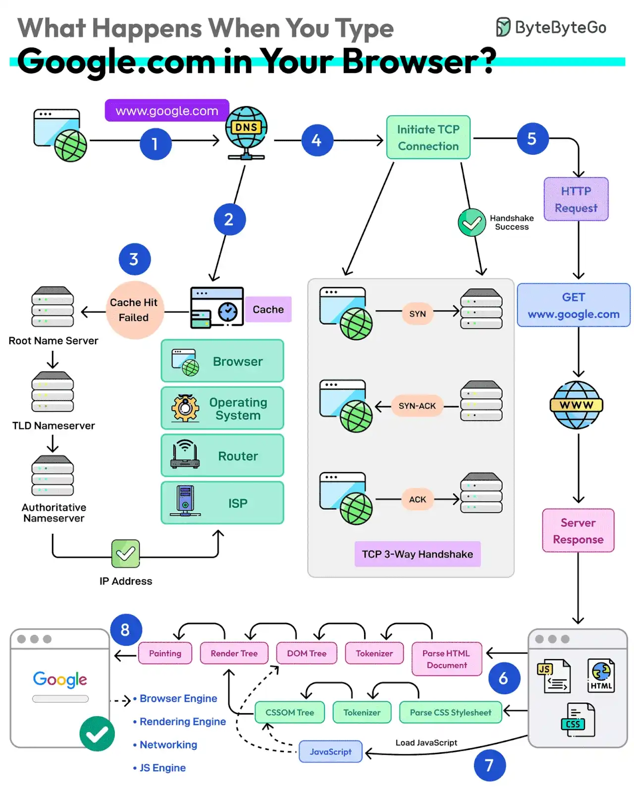
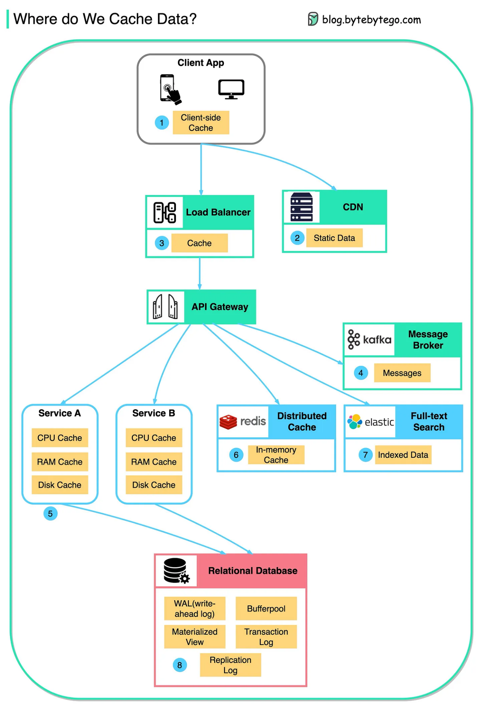
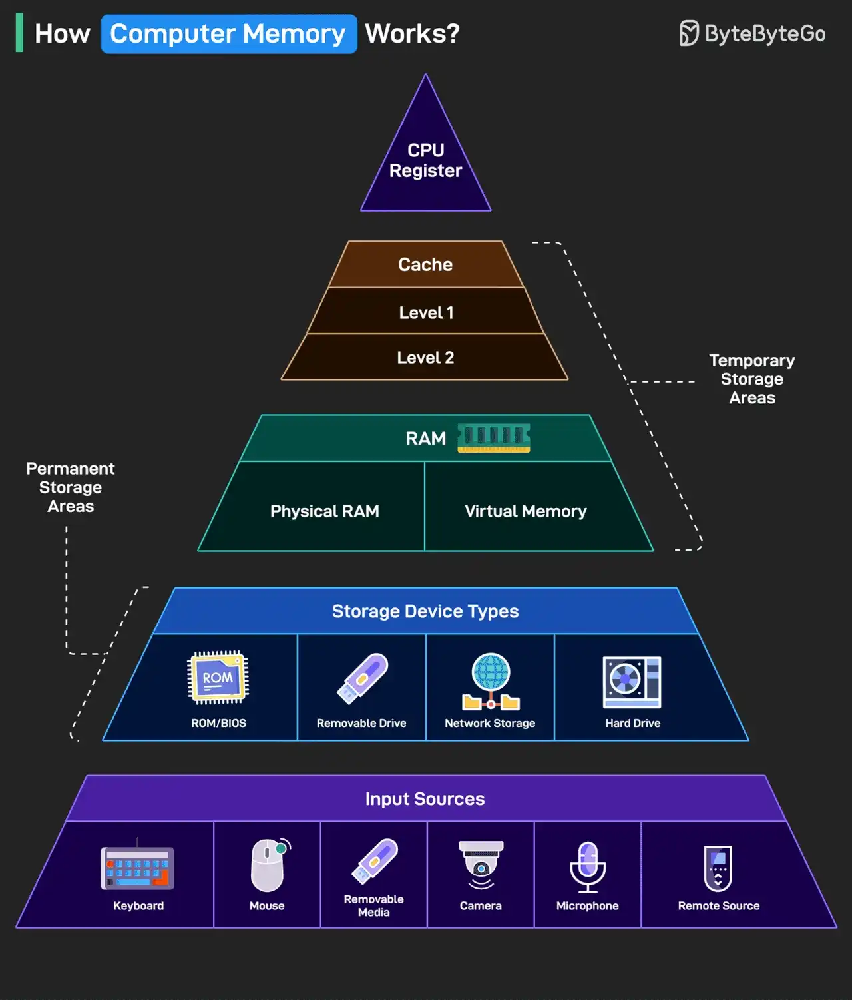
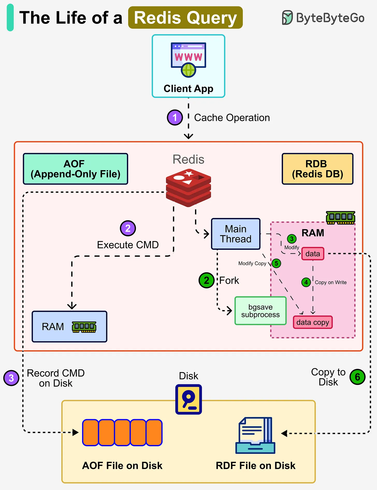
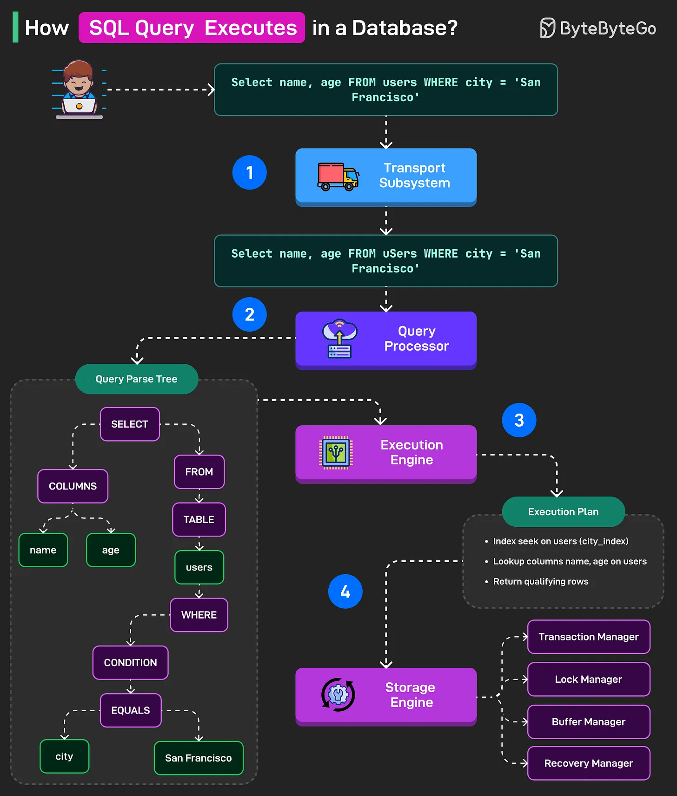
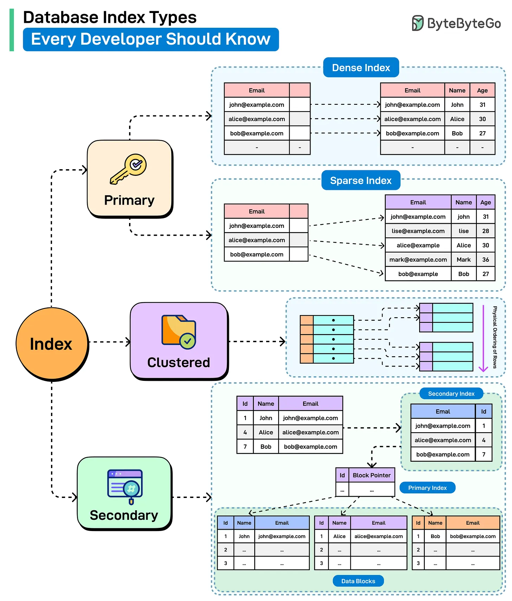

# Một request chậm đi qua hệ thống như thế nào

Từ FE/mobile đến Redis và database

Chúng ta thường gặp một tình huống rất quen: ứng dụng chậm. Nhưng khi chậm, câu hỏi đầu tiên thường lại là câu hỏi sai. Câu hỏi đầu tiên có thể gặp: do frontend, do backend, do Redis hay do database? Thực ra một request đi qua nhiều lớp, và lớp nào cũng có thể trở thành bottleneck.

Ba ý chính của tài liệu này là:

- app chậm không có nghĩa là database chậm
- Redis nhanh không phải vì “tốt hơn database”, mà vì nó giải một bài toán khác
- index giúp database đọc nhanh hơn, nhưng không miễn phí

## Mở bài: Điều gì xảy ra khi bạn gõ google.com vào trình duyệt

Một cách mở bài rất tự nhiên cho chủ đề này là bắt đầu từ một việc ai cũng làm hằng ngày: gõ một địa chỉ vào trình duyệt, hoặc mở Google rồi bắt đầu tìm kiếm.

`Ý chính của hình này:` Một thao tác rất nhỏ ở browser thực ra kéo theo nhiều lớp như cache, DNS, network, HTTP và rendering; vì vậy `app chậm` luôn là câu chuyện nhiều tầng.

Nhìn bức hình này, điều hay nhất là nó gom rất nhiều mảnh kiến thức quen mà thường ngày chúng ta hay tách rời nhau. Mọi thứ bắt đầu từ browser. Browser thử tìm trong cache trước. Nếu cache miss, nó phải tìm IP address của domain. Trên hình, phần đó đi qua các tầng DNS như root nameserver, TLD nameserver và authoritative nameserver. Có IP rồi, browser mới khởi tạo TCP connection, gửi HTTP request, nhận server response, parse HTML và CSS, tạo DOM tree, CSSOM tree rồi mới render ra thứ người dùng nhìn thấy trên màn hình.

Chỉ riêng một hành động tưởng như đơn giản như vậy đã kéo theo rất nhiều lớp:

- browser cache
- DNS
- network
- TCP/TLS
- HTTP
- server
- rendering trên client

Vì vậy khi người dùng nói `web chậm` hay `app chậm`, rất nhiều khả năng là họ đang gom nhiều loại độ trễ khác nhau vào cùng một cảm giác. Có thể chậm ở DNS lookup. Có thể chậm ở bước thiết lập kết nối. Có thể server trả về chậm. Cũng có thể server trả về khá nhanh rồi nhưng browser còn mất thời gian parse, dựng cây và render nên màn hình vẫn hiện chậm.

Phần mở đầu này nhắc lại một điều quan trọng: performance không phải câu chuyện của riêng database, cũng không phải của riêng frontend hay backend. Một request đi qua rất nhiều trạm, và mỗi trạm đều có thể là nơi phát sinh độ trễ.

`Khi gõ một địa chỉ vào trình duyệt đã có quá nhiều lớp cùng tham gia, thì chuyện dữ liệu, cache, Redis và database cũng nên được nhìn như một hành trình nhiều tầng chứ không phải một điểm đơn lẻ.`

### Câu hỏi phần này

- Khi người dùng nói `web chậm`, theo bạn họ đang cảm nhận chậm ở bước nào?
- Nếu phải chọn một chỗ để đo đầu tiên, bạn sẽ đo ở browser, network hay server?

## 1. Một request không đi qua một chỗ duy nhất

Dữ liệu không chỉ sống ở backend hay database. Nó có thể xuất hiện ở rất nhiều lớp khác nhau: trên client, ở CDN, trong service, ở Redis, trong search engine và cả bên trong chính database.

`Ý chính của hình này:` Cache không chỉ là Redis; dữ liệu có thể được giữ lại ở rất nhiều lớp khác nhau, từ client cho tới database.

Nhìn bức tranh này, điều quan trọng nhất không phải là nhớ tên từng box, mà là hiểu một ý: cache có ở khắp nơi. Browser có cache của browser. Ứng dụng có thể nhận dữ liệu từ CDN. Service có thể giữ dữ liệu nóng trong memory. Redis là distributed cache quen thuộc nhất. Ngay cả database cũng có các lớp cache và log riêng của nó.

Nếu nhìn kỹ hơn từ trái sang phải, bức hình đang kể một câu chuyện rất rõ. Ở phía ngoài cùng là `Client App`, nơi response có thể được giữ lại bằng browser cache hoặc app cache để lần sau không cần xin lại từ đầu. Đi tiếp vào trong là `CDN` và đôi khi cả `Load Balancer`, tức là những lớp đứng gần người dùng hơn backend và có thể trả lại dữ liệu hoặc static asset rất nhanh nếu đã có bản sao sẵn.

Vào sâu hơn nữa là các `Service`. Đây là chỗ nhiều người chỉ nghĩ tới business logic, nhưng thực ra service cũng có nhiều tầng cache của riêng nó: CPU cache, memory cache, thậm chí disk cache cục bộ. Sau đó mới tới `Distributed Cache` như Redis, nơi nhiều service cùng đọc và ghi những key nóng. Rồi tới `Full-text Search`, nơi một bản sao dữ liệu được index lại theo cách tối ưu cho search. Và cuối cùng, ngay cả `Relational Database` cũng không chỉ là “một cái bảng trên ổ cứng”. Nó còn có WAL, buffer pool, materialized view, transaction log và replication log.

Ý sâu nhất của hình này là dữ liệu trong hệ thống thường không chỉ tồn tại ở một chỗ. Mỗi lớp thêm vào đều giúp nhanh hơn, nhưng đổi lại là dữ liệu bị nhân bản ra nhiều nơi. Một khi dữ liệu thay đổi, bài toán không còn là “sửa một row trong database” nữa, mà là làm sao để các bản sao ở nhiều tầng không trở nên quá cũ hoặc mâu thuẫn với nhau.

Vì vậy, khi một màn hình tải chậm, nguyên nhân có thể nằm ở rất nhiều nơi:

- client gọi quá nhiều request
- payload quá lớn
- network chậm
- cache miss quá nhiều
- database phải scan quá nhiều dữ liệu

Nói ngắn gọn, `cache không chỉ là Redis`.

### Câu hỏi phần này

- Ngoài Redis, bạn thấy hệ thống của mình đang cache dữ liệu ở những đâu?
- Nếu dữ liệu thay đổi, lớp cache nào theo bạn là khó đồng bộ nhất?

## 2. Vì sao hệ thống phải chia thành nhiều tầng: RAM và ổ cứng

Muốn hiểu Redis và database khác nhau ở đâu, cách dễ nhất là quay về một khái niệm rất cơ bản: máy tính không chỉ có một loại bộ nhớ.

`Ý chính của hình này:` Càng gần CPU thì càng nhanh nhưng càng nhỏ; Redis tận dụng memory để nhanh, còn database phải cân bằng giữa tốc độ và độ bền dữ liệu.

Càng gần CPU thì truy cập càng nhanh, nhưng dung lượng càng nhỏ và chi phí càng đắt. Càng xa CPU thì chậm hơn, nhưng chứa được nhiều hơn và giữ dữ liệu lâu hơn.

Điểm hay của hình này là nó cho thấy vì sao hệ thống nào cũng phải sống chung với trade-off. `CPU register` và `cache` ở gần processor nhất nên rất nhanh, nhưng cực nhỏ. `RAM` rộng hơn nhiều và vẫn khá nhanh, nên nó trở thành nơi làm việc chính của chương trình đang chạy. `Permanent storage` như SSD hoặc HDD chậm hơn hẳn, nhưng bù lại giữ được nhiều dữ liệu hơn và không mất khi tắt máy.

Nếu đem hình này gắn vào câu chuyện Redis và database thì sẽ thấy mọi thứ tự nhiên hơn. Redis nhanh vì phần dữ liệu nó phục vụ đang nằm ở tầng gần CPU hơn, tức là memory. Database chính thường giữ dữ liệu bền vững hơn ở storage, nhưng lại phải cố kéo những phần hay dùng vào buffer/cache trong RAM để tránh đụng vào disk quá nhiều. Nói cách khác, Redis không phải phép màu. Nó chỉ tận dụng một tầng bộ nhớ nhanh hơn để phục vụ một kiểu nhu cầu khác.

Hình này cũng giải thích vì sao `index` lại có ích. Một index tốt giúp database giảm số lần phải đi xuống tầng chậm hơn. Thay vì đọc rất nhiều page từ disk rồi mới tìm ra dữ liệu cần thiết, database có thể dùng cấu trúc tra cứu để chạm ít dữ liệu hơn, và tăng cơ hội những page quan trọng đã nằm sẵn trong memory.

Có thể hình dung:

- RAM giống bàn làm việc
- ổ cứng giống kho lưu trữ

Đồ đang dùng ngay thì để trên bàn cho nhanh. Đồ cần giữ lâu thì để trong kho. Hệ thống thật cũng vận hành theo logic đó. Không có một loại storage nào vừa nhanh nhất, vừa rẻ nhất, vừa lớn nhất, vừa bền dữ liệu nhất. Vì vậy chúng ta luôn phải đánh đổi giữa tốc độ và độ bền dữ liệu.

Đây là nền để hiểu vì sao Redis nhanh, và vì sao database vẫn cần tồn tại.

### Câu hỏi phần này

- Vì sao hệ thống không thể chỉ dùng một loại storage cho tất cả mọi thứ?
- Theo bạn, tốc độ và độ bền dữ liệu thường đang đánh đổi với nhau như thế nào?

## 3. Redis là gì

Redis là một `in-memory data store`, nghĩa là phần dữ liệu nó phục vụ chủ yếu nằm trong RAM. Nhờ vậy, Redis đọc và ghi rất nhanh, đặc biệt hợp với những thứ bị truy cập lặp đi lặp lại và cần phản hồi gần như tức thì.

Một số use case quen thuộc của Redis:

- cache
- session
- rate limiting
- counter
- leaderboard
- hot key lookup

`Ý chính của hình này:` Redis xử lý dữ liệu trong RAM để nhanh, rồi dùng AOF hoặc RDB để giảm rủi ro mất dữ liệu khi cần persistence.

Nếu chỉ nhìn vào tốc độ, rất dễ nảy ra câu hỏi: Redis nhanh như vậy, tại sao không dùng Redis thay luôn database?

Lý do là Redis và database thường phục vụ hai vai trò khác nhau.

- Redis ưu tiên tốc độ truy cập
- database chính ưu tiên lưu trữ bền vững, consistency, transaction và khả năng query

Có thể nhớ bằng một hình dung rất đời thường:

- Redis giống quầy đồ đang bày sẵn trước mặt
- database giống kho chính thức của cửa hàng

Quầy đồ giúp lấy nhanh hơn, nhưng kho mới là nơi giữ hàng hóa chính thức.

Chính bức hình này giúp trả lời rõ hơn. Ở giữa là Redis xử lý command ngay trong RAM, nên request đi rất nhanh. Nhưng từ điểm đó tách ra hai hướng persistence khác nhau. Nhánh `AOF` ghi lại từng command xuống disk theo dạng nhật ký để sau này có thể replay lại. Nhánh `RDB` thì không ghi từng lệnh, mà fork ra tiến trình `bgsave`, dùng copy-on-write để chụp snapshot của dataset rồi ghi snapshot đó xuống disk. Hai hướng này cho thấy Redis không chỉ chạy nhanh, nó còn phải xử lý một bài toán khác: nếu dữ liệu sống trong memory, làm sao giảm rủi ro mất dữ liệu khi crash hoặc restart.

Điều đáng chú ý là Redis luôn ưu tiên xử lý dữ liệu trong memory trước, rồi mới lo phần persistence theo cách phù hợp. Đó là lý do Redis cho cảm giác rất nhanh, nhưng cũng là lý do phải chấp nhận trade-off. Nếu muốn bền dữ liệu hơn, phải ghi xuống disk nhiều hơn. Mà đã ghi xuống disk nhiều hơn thì chi phí cũng tăng lên. Hình này cũng ngầm cho thấy vì sao nhiều hệ thống production dùng cả AOF lẫn RDB: một bên giữ lịch sử lệnh chi tiết hơn, một bên giúp reload nhanh hơn bằng snapshot gọn hơn.

### Câu hỏi phần này

- Use case nào trong hệ thống của bạn hợp với Redis nhất?
- Nếu một dữ liệu rất quan trọng chỉ nằm trong Redis, bạn thấy rủi ro lớn nhất là gì?

## 4. Redis có lưu dữ liệu xuống disk không

Có, và đây cũng là chỗ nhiều người dễ hiểu nhầm. Redis nổi tiếng vì chạy trên memory, nhưng không có nghĩa là nó bỏ hẳn chuyện persistence.

Hai cơ chế hay được nhắc nhất là `AOF` và `RDB`.

`AOF` là `Append-Only File`.

- Redis thực thi lệnh trong memory
- sau đó ghi lệnh vào file log theo kiểu append
- khi cần khôi phục, Redis có thể replay lại các lệnh đó

`RDB` là snapshot của dữ liệu tại một thời điểm.

- Redis định kỳ chụp lại trạng thái dataset
- snapshot được ghi xuống disk
- khi restart, Redis có thể nạp snapshot để khôi phục nhanh

Nói gọn lại:

- `AOF` giống nhật ký lệnh
- `RDB` giống ảnh chụp nhanh dữ liệu

Trong thực tế có thể dùng một trong hai, hoặc kết hợp cả hai, tùy hệ thống muốn cân bằng thế nào giữa tốc độ, độ an toàn dữ liệu và thời gian khôi phục.

Chốt lại, Redis có thể ghi dữ liệu xuống disk, nhưng như vậy vẫn chưa đủ để biến nó thành lựa chọn mặc định cho toàn bộ dữ liệu business chính.

### Câu hỏi phần này

- Nếu phải mô tả thật ngắn, bạn sẽ giải thích AOF và RDB khác nhau thế nào?
- Theo bạn, vì sao có hệ thống lại muốn dùng cả AOF lẫn RDB thay vì chỉ chọn một?

## 5. Database là gì

Trong ngữ cảnh buổi này, `database` chủ yếu là relational database như PostgreSQL hoặc MySQL.

Đây thường là nơi giữ `source of truth` của dữ liệu business:

- dữ liệu người dùng
- đơn hàng
- giao dịch
- trạng thái nghiệp vụ

Database quan hệ không chỉ lưu dữ liệu. Nó còn cung cấp schema, constraint, transaction và query engine để dữ liệu vừa tồn tại bền vững, vừa có thể được đọc và cập nhật theo những cách phức tạp hơn.

Nếu Redis giống quầy đồ đang mở sẵn, thì database giống kho chính thức có sổ sách, quy tắc nhập xuất và cơ chế kiểm kê rõ ràng.

### Câu hỏi phần này

- Với dữ liệu business quan trọng của hệ thống, vì sao database chính vẫn thường là nơi giữ source of truth?

## 6. Một câu SQL thực ra chạy như thế nào

Khi ứng dụng gửi một câu SQL, database không chạy ngay theo đúng dòng chữ đó. Nó phải đi qua nhiều bước xử lý ở bên trong.

`Ý chính của hình này:` Một câu SQL phải đi qua parser, optimizer và execution engine; nhanh hay chậm phụ thuộc nhiều vào execution plan chứ không chỉ vào câu lệnh nhìn bằng mắt thường.

Ở mức tổng quan, database thường làm bốn việc lớn:

1. nhận kết nối và query
2. parse cú pháp
3. optimizer chọn execution plan
4. execution engine đọc hoặc ghi dữ liệu qua storage engine

Đây là lý do cùng một câu query, lúc thì nhanh, lúc thì chậm. Tốc độ không chỉ nằm ở câu SQL nhìn bằng mắt thường, mà còn nằm ở execution plan, statistics, index và chuyện dữ liệu có sẵn trong memory hay chưa.

Nếu nhìn sát vào bức hình, có thể xem nó như một dây chuyền nhiều trạm. `Transport Subsystem` là cửa vào, nơi database nhận kết nối, kiểm tra auth và đưa query vào bên trong. `Query Processor` mới là nơi câu SQL được phân tích thật sự: parser xem cú pháp có hợp lệ không, còn optimizer cố tìm cách chạy ít tốn kém nhất. Kết quả của đoạn này không phải dữ liệu trả về ngay, mà là một `execution plan`.

`Execution Engine` nhận plan đó rồi điều phối từng bước đọc hoặc ghi. Nhưng bản thân nó cũng chưa tự cầm dữ liệu lên được. Nó phải gọi `Storage Engine`, nơi các thành phần như transaction manager, lock manager, buffer manager và recovery manager cùng tham gia. Bức hình này quan trọng ở chỗ nó làm lộ ra một sự thật hay bị bỏ qua: câu SQL chúng ta viết chỉ là đầu vào. Thứ quyết định nhanh hay chậm là database hiểu câu đó thế nào và chọn đường đi nào để thực thi nó.

Đây cũng là chỗ nối sang câu chuyện `EXPLAIN`. Khi query chậm, điều đáng xem không chỉ là câu lệnh, mà là plan mà database đã chọn. Có index nhưng optimizer không dùng thì query vẫn chậm. Có index đúng nhưng page chưa vào buffer cache thì query vẫn có thể chậm vì phải đọc disk. Vì vậy tối ưu query không thể dừng ở mức “viết SQL cho gọn”.

Vì vậy, khi gặp query chậm, không nên chỉ nhìn câu SQL rồi đoán. Cần hiểu database đang quyết định chạy nó theo cách nào.

### Câu hỏi phần này

- Vì sao cùng một câu SQL mà lúc nhanh lúc chậm?
- Nếu query chậm, thứ bạn muốn xem đầu tiên là câu SQL hay execution plan?

## 7. Index là gì

Index là một cấu trúc tra cứu phụ giúp database tìm dữ liệu nhanh hơn mà không phải quét toàn bộ bảng.

Cách dễ nhớ nhất là xem index như:

- mục lục của một cuốn sách
- hoặc sơ đồ kệ hàng trong một kho

Nếu không có index, database có thể phải nhìn qua rất nhiều row để tìm thứ cần thiết. Nếu có index phù hợp, database biết đường đi ngắn hơn để tới dữ liệu.

Nếu nói kỹ hơn một chút, index cũng là dữ liệu. Nó không phải một ý niệm trừu tượng mà là một cấu trúc thật được database tạo thêm bên cạnh bảng chính. Trong cấu trúc đó, database lưu `giá trị dùng để tìm kiếm` cùng với `đường dẫn` hoặc `pointer` để quay về row thật. Chính vì index là một cấu trúc dữ liệu bổ sung như vậy, nó không miễn phí.

Khi một bảng có index, database phải trả ít nhất ba loại chi phí:

- `tốn ổ cứng` vì phải lưu thêm cấu trúc index bên cạnh dữ liệu gốc
- `tốn RAM` vì những page của index thường được kéo vào buffer pool hoặc memory cache để tra cứu nhanh hơn
- `tốn chi phí ghi` vì mỗi lần insert, update hoặc delete, database không chỉ sửa dữ liệu gốc mà còn phải cập nhật index liên quan

Điểm quan trọng nhất là phải tách `bản chính` và `bản cache`.

- Bản chính của index nằm trên disk/storage để còn tồn tại sau restart.
- Khi database chạy, các page của index được đọc lên RAM và giữ lại trong buffer pool hoặc memory cache nếu chúng đang được dùng nhiều.

Vì vậy có thể hiểu theo kiểu thực tế là index thường `có mặt ở cả disk lẫn RAM`, nhưng không phải theo nghĩa hai bản độc lập ngang nhau. Disk là nơi lưu trữ lâu dài. RAM là nơi database giữ những page nóng để tra cứu nhanh hơn. Nếu index nhỏ hoặc bị truy cập liên tục, có lúc gần như toàn bộ index có thể nằm trong RAM. Nếu index lớn, chỉ một phần của nó nằm trong RAM tại một thời điểm.

`Ý chính của hình này:` Index không chỉ có một kiểu; primary, clustered và secondary index giúp query nhanh theo những cách khác nhau và đi kèm các trade-off khác nhau.

Index giúp đọc nhanh hơn, nhưng không miễn phí. Cái giá của nó là:

- tốn thêm storage
- tốn thêm RAM khi index page được giữ trong buffer pool hoặc memory cache
- insert, update, delete phải tốn thêm công cập nhật index
- không phải query nào cũng hưởng lợi như nhau

Vì vậy không nên nghĩ theo kiểu “cứ chậm là thêm index”.

Nếu nhìn kỹ hình index này, sẽ thấy nó đang nhấn vào ba nhóm rất dễ bị lẫn với nhau: `Primary`, `Clustered` và `Secondary`.

`Primary index` thường gắn với primary key. Trong hình còn nhắc thêm hai ý nhỏ là `dense` và `sparse`. Dense index nghĩa là gần như mỗi row đều có một entry trong index. Sparse index thì chỉ giữ entry cho một số mốc hoặc block đại diện. Ý chính ở đây là index không phải lúc nào cũng phải chi tiết tới từng row theo cùng một cách.

`Clustered index` là phần quan trọng nhất của hình này. Nó quyết định thứ tự lưu trữ vật lý của row trong table. Vì dữ liệu chỉ có thể được sắp theo một thứ tự vật lý tại một thời điểm, nên một table thường chỉ có một clustered index. Đây là lý do clustered index rất hợp với range query và ordered scan: dữ liệu liên quan đã nằm gần nhau sẵn.

`Secondary index` là cấu trúc phụ tách riêng khỏi dữ liệu chính. Nó giữ key tìm kiếm cùng với pointer để quay về row thật. Điểm mạnh của nó là có thể tạo thêm cho nhiều cột khác nhau mà không phải thay đổi thứ tự lưu vật lý của bảng. Đổi lại, thường sẽ có thêm bước lookup để quay về dữ liệu thật.

Nhìn theo đúng tinh thần của hình này, câu hỏi hay không phải là “có index hay không”, mà là `đây là loại index nào và nó đang giúp query bằng cách sắp dữ liệu thật hay chỉ tạo một đường dẫn phụ tới dữ liệu`. Hiểu được chỗ đó thì sẽ dễ nối hơn sang phần trade-off của index và phần `index nằm ở RAM hay ổ cứng`.

### Câu hỏi phần này

- Theo bạn, index đang giúp database nhanh hơn bằng cách nào?
- Vì sao không thể thêm index cho mọi cột rồi coi như xong?

## 8. Index nằm ở RAM hay ổ cứng

Câu trả lời ngắn là: `bản chính ở ổ cứng, phần đang dùng thì có thể nằm trong RAM`.

Nói rõ hơn:

- Index được lưu bền vững trên disk/storage, nên sau khi restart database nó vẫn còn.
- Khi query chạy, database đọc các page index cần thiết lên RAM.
- Nếu các page đó tiếp tục được dùng nhiều, chúng có thể ở lại trong buffer pool hoặc memory cache.
- Nếu RAM không đủ, một phần page index sẽ bị đẩy ra và lần sau query lại phải đọc từ disk.

Vì vậy, nói `index nằm trên ổ cứng` là đúng khi đang nói về nơi lưu trữ lâu dài. Nói `index cũng nằm trong RAM` cũng đúng nếu đang nói về lúc hệ thống chạy thật và database đang cache các page index để tăng tốc truy cập.

Đó cũng là lý do thêm index không chỉ tốn disk mà còn có thể tốn RAM:

- thêm nhiều index nghĩa là thêm nhiều page index có khả năng cạnh tranh RAM với data page
- nếu RAM đủ lớn, nhiều query sẽ hưởng lợi vì index page đã nằm sẵn trong memory
- nếu RAM không đủ, database vẫn phải thường xuyên đọc index page từ disk, khi đó lợi ích thực tế giảm đi

Đây chính là chỗ nối lại với phần `RAM vs ổ cứng`. Database không chỉ lưu dữ liệu và index, mà còn liên tục quyết định phần nào nên được giữ nóng trong memory để giảm số lần phải chạm xuống tầng chậm hơn.

### Câu hỏi phần này

- Nếu ai đó hỏi `index nằm ở RAM hay ổ cứng`, bạn sẽ trả lời sao?

## 9. Vậy Redis và database khác nhau ở đâu

Nếu cần chốt trong một câu ngắn, có thể nói thế này:

- Redis thường là lớp tăng tốc
- database thường là nơi giữ sự thật của dữ liệu

Redis rất mạnh khi:

- cần truy cập cực nhanh
- dữ liệu nóng được đọc lặp đi lặp lại
- có thể chấp nhận một mức trade-off nhất định về persistence hoặc consistency tùy bài toán

Database chính mạnh khi:

- cần lưu trữ bền vững
- cần transaction rõ ràng
- cần query nhiều kiểu
- cần đảm bảo dữ liệu business quan trọng được quản lý chặt chẽ

Đây không phải cuộc thi “công nghệ nào tốt hơn”. Chúng thường bổ sung cho nhau.

### Câu hỏi phần này

- Trong hệ thống của bạn, Redis đang đóng vai trò tăng tốc hay đang gánh cả dữ liệu chính?
- Sau phần này, bạn phân biệt Redis và database bằng một câu ngắn như thế nào?

## 10. Mỗi nhóm nên mang gì về sau buổi này

Với frontend và mobile, điều đáng nhớ là trải nghiệm chậm không phải chỉ do backend. Số lượng request, payload size, cache policy, prefetch, retry và network waterfall đều tác động trực tiếp tới cảm giác nhanh chậm của người dùng.

Với backend, điều đáng nhớ là không nên nghĩ Redis là thuốc chữa bách bệnh, cũng không nên nghĩ query chậm thì cứ thêm index. Cần hiểu query pattern, cache hit ratio và execution plan trước khi tối ưu.

Với cả team, điều quan trọng nhất là cùng dùng một mental model chung: khi hệ thống chậm, hãy hỏi độ trễ đang nằm ở lớp nào.

### Câu hỏi phần này

- Với vai trò hiện tại của bạn, bạn tác động được nhiều nhất vào lớp nào để cải thiện performance?

## 11. Một vài câu hỏi thường gặp

### Nếu Redis nhanh vậy, sao không bỏ luôn database

Vì Redis và database tối ưu cho hai bài toán khác nhau. Redis ưu tiên tốc độ truy cập trên memory. Database chính ưu tiên durability, consistency, transaction và query capability.

### Redis đã có AOF và RDB rồi thì có thể làm source of truth không

Có những trường hợp Redis có thể giữ dữ liệu chính, nhưng trong đa số business application thông thường, relational database vẫn là lựa chọn phổ biến hơn để giữ source of truth.

### Thêm index có luôn tốt không

Không. Index thường giúp read nhanh hơn nhưng làm write đắt hơn, tốn storage hơn và chưa chắc query planner đã dùng nếu query pattern không phù hợp.

### Cache có phải lúc nào cũng tốt không

Không. Cache giúp nhanh hơn, nhưng đổi lại là bài toán stale data, invalidation, consistency và đôi khi là cả chuyện xóa dữ liệu ở nhiều tầng.

## 12. Tổng hợp câu hỏi thảo luận

1. Khi một màn hình trong app tải chậm, phản xạ đầu tiên của bạn thường là nghi ngờ lớp nào: client, network, API, cache hay database?

2. Theo bạn, câu `app chậm` thường đang mô tả điều gì: thời gian render trên client, thời gian chờ network, thời gian xử lý backend hay thời gian đọc dữ liệu?

3. Theo bạn, dữ liệu có thể được cache ở những đâu ngoài Redis?

4. Nếu cùng một dữ liệu xuất hiện ở browser cache, CDN, Redis và database, điều gì sẽ là khó nhất khi dữ liệu thay đổi?

5. Vì sao dữ liệu nằm trong RAM thường nhanh hơn dữ liệu phải đọc từ ổ cứng?

6. Nếu Redis nhanh như vậy, vì sao đa số hệ thống vẫn không dùng Redis để thay toàn bộ database chính?

7. Theo bạn, use case nào hợp với Redis hơn: session, transaction lịch sử đơn hàng nhiều năm, rate limiting hay bảng xếp hạng?

8. Nếu Redis là in-memory data store, vậy khi process chết hoặc máy restart thì chuyện gì có thể xảy ra?

9. Theo bạn, `AOF` và `RDB` giải quyết vấn đề gì của Redis?

10. Nếu phải nói rất ngắn, bạn sẽ mô tả `AOF` và `RDB` khác nhau như thế nào?

11. Vì sao cùng là một câu SQL nhưng lúc thì chạy nhanh, lúc thì chạy chậm?

12. Theo bạn, index đang giải quyết bài toán gì trong database?

13. Nếu thêm index thì cái giá phải trả thường là gì?

14. Theo bạn, index nằm ở RAM hay ở ổ cứng?

15. Sau buổi này, nếu gặp một API hoặc màn hình chậm, bạn sẽ hỏi câu gì đầu tiên?

16. Với vai trò hiện tại của bạn, bạn thấy mình có thể tác động vào lớp nào nhiều nhất để cải thiện performance?

## 13. Điều cuối cùng nên nhớ

Một hệ thống nhanh không đến từ một công nghệ thần kỳ. Nó đến từ việc mỗi lớp trong hệ thống được hiểu đúng vai trò và đúng trade-off của nó.

Khi app chậm, đừng hỏi ngay `database có vấn đề không`. Hãy hỏi trước: `độ trễ đang nằm ở lớp nào`.
