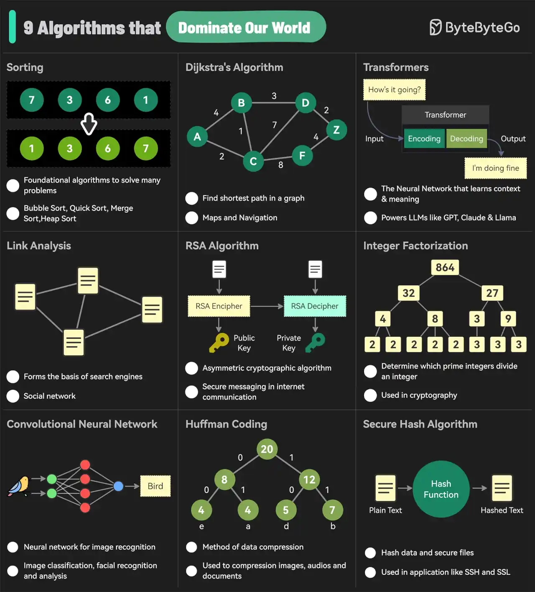

# 001 - The 9 Algorithms That Dominate Our World

- Source: ByteByteGo Big Archive System Design 2025
- PDF pages: 8-9
- Figures: 1

## Figures

## Original Extracted Text

The diagram below shows the most commonly used algorithms in our daily lives. They are used in
internet search engines, social networks, WiFi, cell phones, and even satellites.

   1. Sorting
   2. Dijkstra's Algorithm
   3. Transformers
   4. Link Analysis
   5. RSA Algorithm
   6. Integer Factorization

   7. Convolutional Neural Networks
   8. Huffman Coding
   9. Secure Hash Algorithm
Over to you: Are there any other commonly used algorithms we missed?
