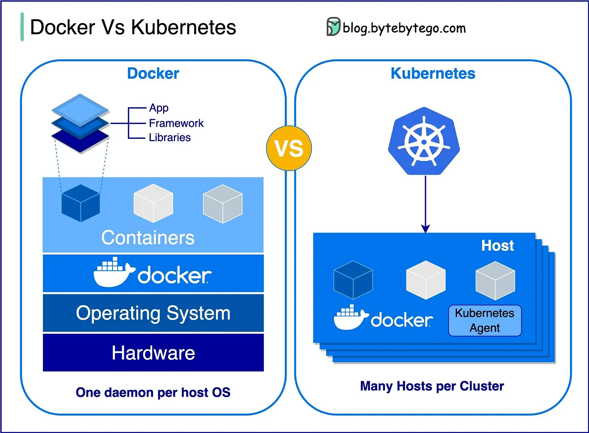

# 004 - Docker vs. Kubernetes. Which one should we use?

- Source: ByteByteGo Big Archive System Design 2025
- PDF pages: 14-15
- Figures: 1

## Figures

## Original Extracted Text

What is Docker ?

Docker is an open-source platform that allows you to package, distribute, and run applications in
isolated containers. It focuses on containerization, providing lightweight environments that
encapsulate applications and their dependencies.

What is Kubernetes ?

Kubernetes, often referred to as K8s, is an open-source container orchestration platform. It provides
a framework for automating the deployment, scaling, and management of containerized applications
across a cluster of nodes.

How are both different from each other ?

Docker: Docker operates at the individual container level on a single operating system host.

You must manually manage each host and setting up networks, security policies, and storage for
multiple related containers can be complex.

Kubernetes: Kubernetes operates at the cluster level. It manages multiple containerized applications
across multiple hosts, providing automation for tasks like load balancing, scaling, and ensuring the
desired state of applications.

In short, Docker focuses on containerization and running containers on individual hosts, while
Kubernetes specializes in managing and orchestrating containers at scale across a cluster of hosts.

Over to you: What challenges prompted you to switch from Docker to Kubernetes for managing
containerized applications?
