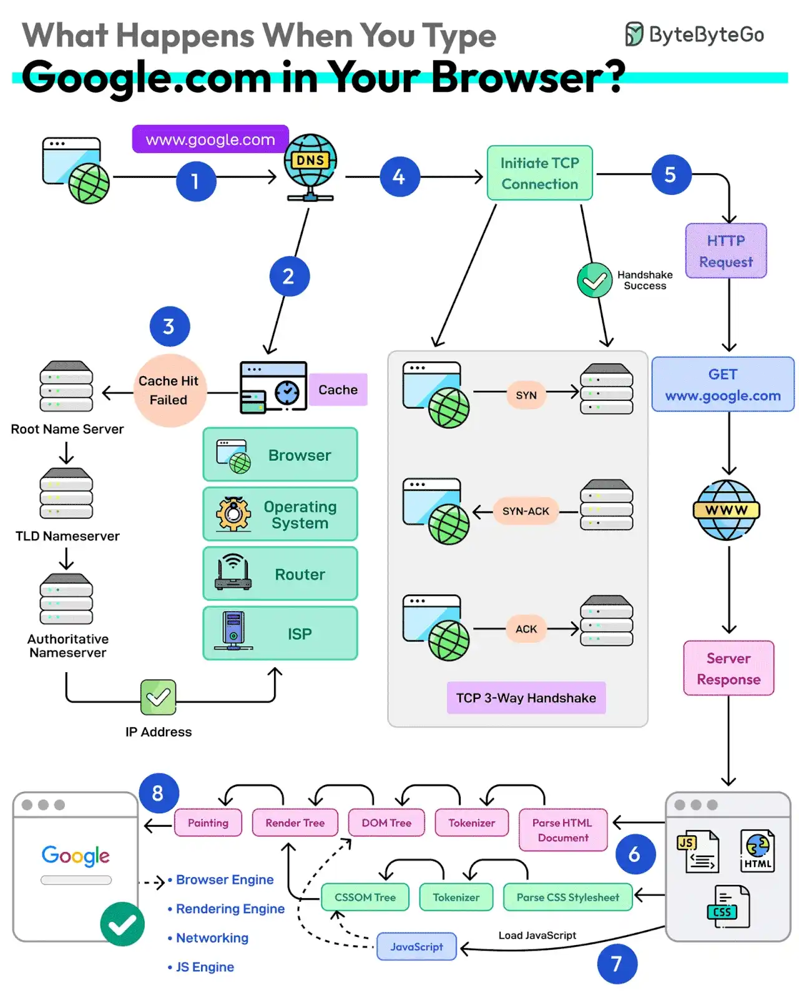

# 006 - What happens when you type google .com into a browser?

- Source: ByteByteGo Big Archive System Design 2025
- PDF pages: 18-19
- Figures: 1

## Figures

## Original Extracted Text

1. First up, you type the website address in the browser's address bar.

 2. The browser checks its cache first. If there's a cache miss, it must find the IP address.

 3. DNS lookup begins (think of it as looking up a phone number). The request goes through
     different DNS servers (root, TLD, and authoritative). Finally, the IP address is retrieved.

   4. Next, your browser initiates a TCP connection like a handshake. For example, in the case of
       HTTP 1.1, the client and server perform a TCP three-way handshake with SYN, SYN-ACK,
       and ACK messages.

   5. Once the handshake is successful, the browser makes an HTTP request to the server and
       the server responds with HTML, CSS, and JS files.

   6. Finally, the browser processes everything. It parses the HTML document and creates DOM
       and CSSOM trees.

   7. The browser executes the JavaScript and renders the page through various steps (tokenizer,
       parser, render tree, layout, and painting).

   8. Finally, the webpage appears on your screen.

Over to you: Which other step will you add to the overall process?
