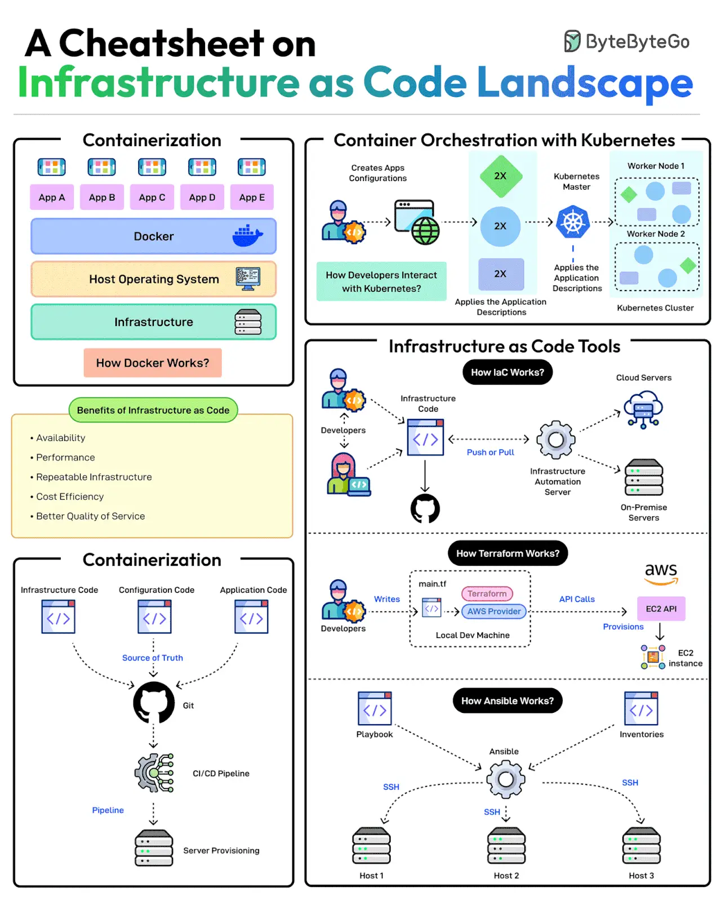

# 007 - A Cheatsheet on Infrastructure as Code Landscape

- Source: ByteByteGo Big Archive System Design 2025
- PDF pages: 20-21
- Figures: 1

## Figures

## Original Extracted Text

Scalable infrastructure provisioning provides several benefits related to availability, scalability,
repeatability, and cost-effectiveness.

But how do you achieve this?

Provisioning infrastructure using code is the key to scalable infra management.
There are multiple strategies that can help:

   1. Containerization is one of the first strategies to make application deployments based on
       code. Docker is one of the most popular ways to containerize the application.

   2. Next, container orchestration becomes a necessity when dealing with multiple containers in
       an application. This is where container orchestration tools like Kubernetes become
       important.

   3. IaC treats infrastructure provisioning and configuration as code, allowing developers to
       define the application infrastructure in files that can be versioned, tested, and reused.
       Popular tools such as Terraform, AWS CloudFormation, and Ansible can be used. Ansible is
       more of a configuration tool.

   4. GitOps leverages a Git workflow combined with CI/CD to automate infrastructure and
       configuration updates.

Over to you: Have you used Infrastructure as Code for your projects?
