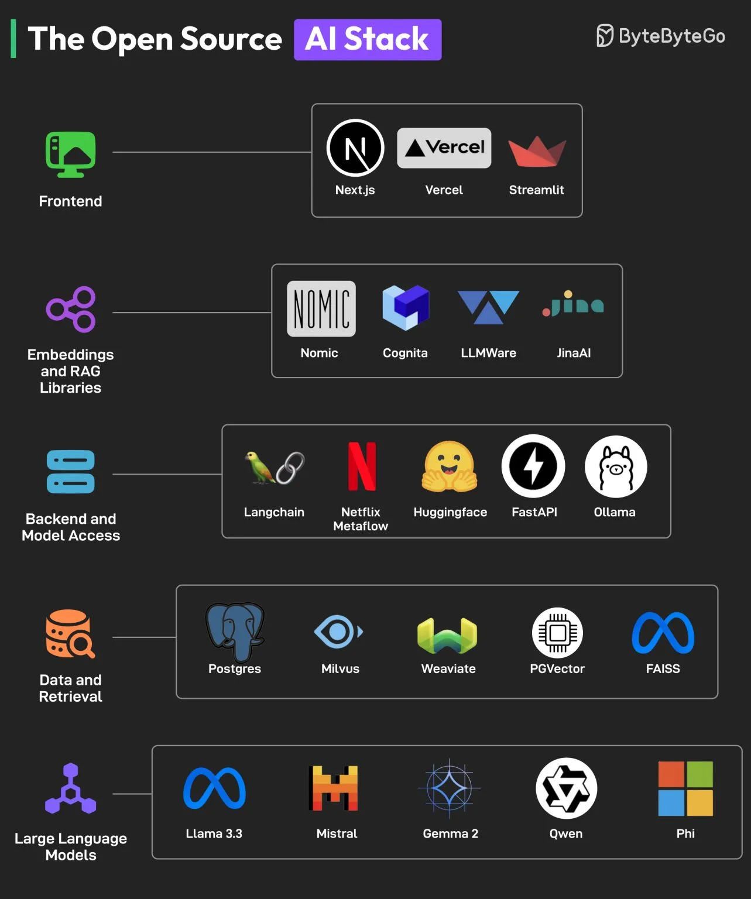

# 009 - The Open Source AI Stack

- Source: ByteByteGo Big Archive System Design 2025
- PDF pages: 24-25
- Figures: 1

## Figures

## Original Extracted Text

You don't need to spend a fortune to build an AI application. The best AI developer tools are
open-source, and an excellent ecosystem is evolving that can make AI accessible to everyone.
The key components of this open-source AI stack are as follows:

   1. Frontend
       To build beautiful AI UIs, frameworks like NextJS and Streamlit are extremely useful. Also,
       Vercel can help with deployment.

2. Embeddings and RAG libraries
    Embedding models and RAG libraries like Nomic, JinaAI, Cognito, and LLMAware help
    developers build accurate search and RAG features.

3. Backend and Model Access
    For backend development, developers can rely on frameworks like FastAPI, Langchain, and
    Netflix Metaflow. Options like Ollama and Huggingface are available for model access.

4. Data and Retrieval
    For data storage and retrieval, several options like Postgres, Milvus, Weaviate, PGVector,
    and FAISS are available.

5. Large-Language Models
    Based on performance benchmarks, open-source models like Llama, Mistral, Qwen, Phi, and
    Gemma are great alternatives to proprietary LLMs like GPT and Claude.

    Over to you: Which other tool will you add to the Open Source AI Stack?
