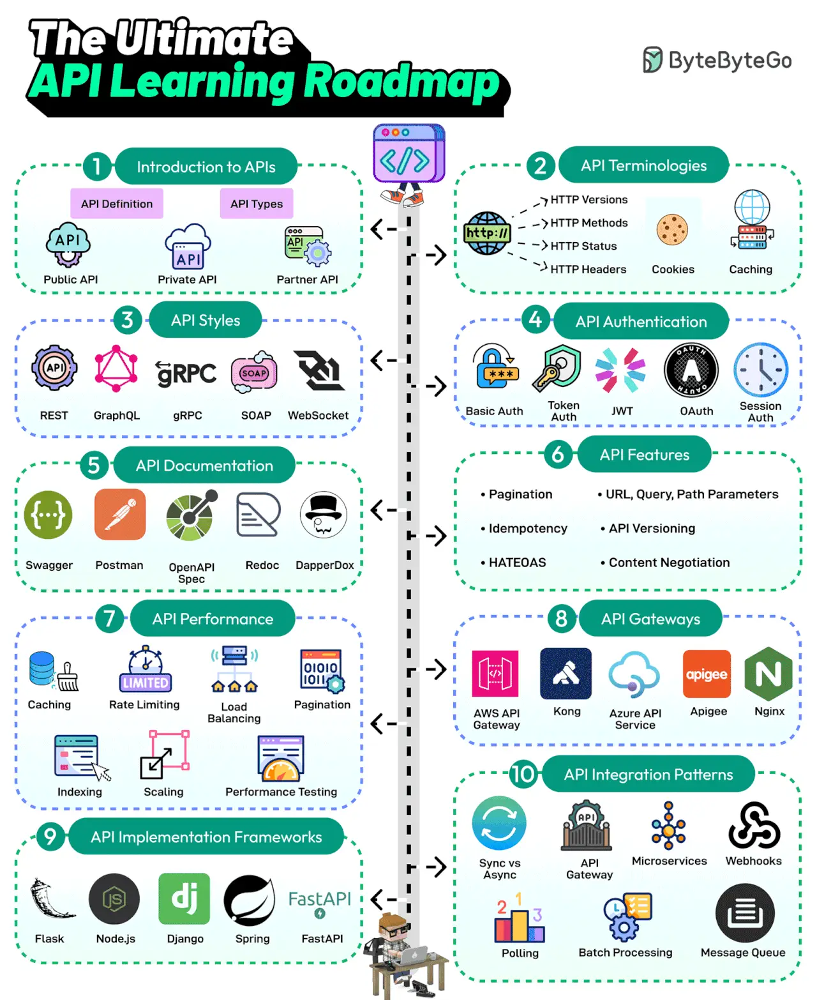

# 012 - The Ultimate API Learning Roadmap

- Source: ByteByteGo Big Archive System Design 2025
- PDF pages: 30-31
- Figures: 1

## Figures

## Original Extracted Text

APIs are the backbone of communication over the Internet. Every developer needs to learn about
APIs. Here's a roadmap that covers the most important topics:

   1. Introduction to APIs
       API is a set of protocols and tools for building applications. Different types of APIs exist, such
       as public, private, and partner.

   2. API Terminologies
       Various API terminologies, such as HTTP versions, cookies, and caching, need to be
       understood.

   3. API Styles
       The most common API styles are REST, SOAP, GraphQL, gRPC, and WebSockets

   4. API Authentication
       API Authentication techniques like Basic Auth, Token, JWTs, OAuth, and Session Auth

   5. API Documentation
       A good API is understandable. API Documentation tools like Swagger, Postman, Redoc, and
       DapperDox make it possible.

   6. API Features
       Key API features include pagination, parameters, idempotency, API versioning, HATEOAS,
       and content negotiation

   7. API Performance Techniques
       Common API performance techniques are caching, rate limiting, load balancing, pagination,
       DB indexing, scaling, and performance testing.

   8. API Gateways
       Learn about API Gateways such as Amazon API Gateway, Azure API Services, Kong, Nginx,
       etc.

   9. API Implementation Frameworks
       The most popular API development frameworks are Node.js, Spring, Flask, Django, and
       FastAPI

   10.API Integration Patterns
       Learn about various API integration patterns such as gateways, event-driven, webhook,
       polling, and batch processing.

Over to you: What else will you add to the API learning roadmap?
