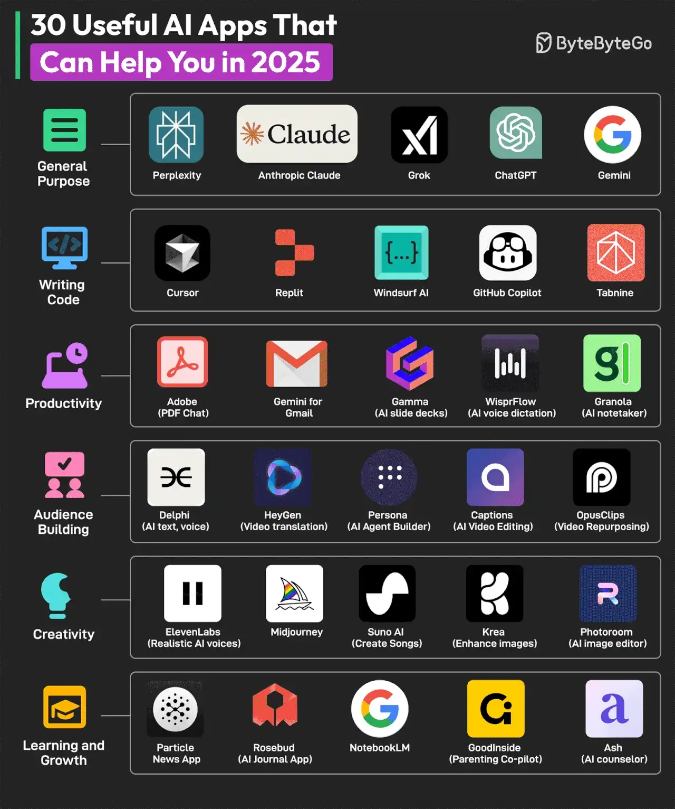

# 013 - 30 Useful AI Apps That Can Help You in 2025

- Source: ByteByteGo Big Archive System Design 2025
- PDF pages: 32-33
- Figures: 1

## Figures

## Original Extracted Text

AI apps are taking over the world. There's an AI app for every conceivable use case. Here are some
AI apps for different categories:

   1. General Purpose: Perplexity, Anthropic Claude, Grok, ChatGPT, and Gemini

   2. Writing Code: Cursor, Replit, Windsurf AI, Github Copilot, and Tabnine

   3. Productivity: Adobe (PDF Chat), Gemini for Gmail, Gamma (AI slide deck), WisprFlow (AI
       voice dictation), and Granola (AI notetaker)

   4. Audience Building: Delphi (AI text, voice), HeyGen (video translation), Persona (AI agent
       builder), Captions (AI video editing), and OpusClips (Video repurposing)

   5. Creativity: ElevenLabs (realistic AI voices), Midjourney, Suno AI (music generation), Krea
       (enhance images), and Photoroom (AI image editing)

   6. Learning and Growth: Particle News App, Rosebud (AI journal app), NotebookLM,
       GoodInside (parenting co-pilot), and Ash (AI counselor).

Over to you: Which other AI app will you add to the list?
