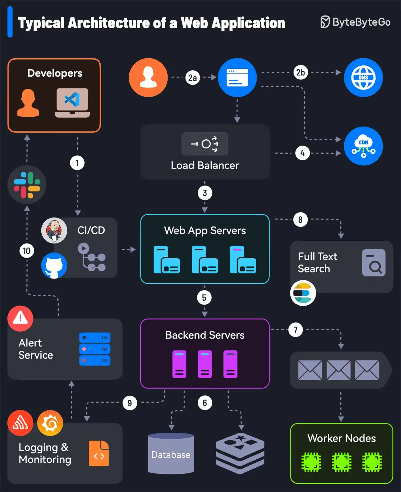

# 014 - 10 Essential Components of a Production Web Application

- Source: ByteByteGo Big Archive System Design 2025
- PDF pages: 34-35
- Figures: 1

## Figures

## Original Extracted Text

1. It all starts with CI/CD pipelines that deploy code to the server instances. Tools like Jenkins
     and GitHub help over here.

 2. The user requests originate from the web browser. After DNS resolution, the requests reach
     the app servers.

 3. Load balancers and reverse proxies (such as Nginx & HAProxy) distribute user requests
     evenly across the web application servers.

 4. The requests can also be served by a Content Delivery Network (CDN).

 5. The web app communicates with backend services via APIs.

   6. The backend services interact with database servers or distributed caches to provide the
       data.

   7. Resource-intensive and long-running tasks are sent to job workers using a job queue.

   8. The full-text search service supports the search functionality. Tools like Elasticsearch and
       Apache Solr can help here.

   9. Monitoring tools (such as Sentry, Grafana, and Prometheus) store logs and help analyze
       data to ensure everything works fine.

   10.In case of issues, alerting services notify developers through platforms like Slack for quick
       resolution.

Over to you: What other components would you add to the architecture of a production web app?
