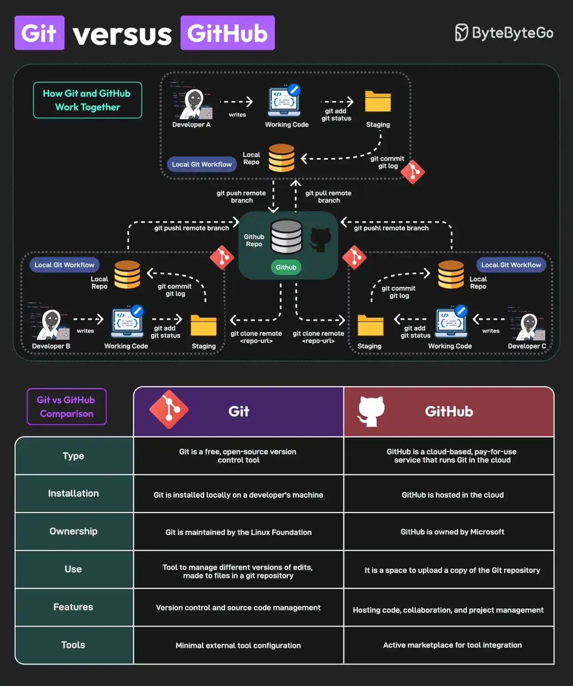

# 019 - Git vs GitHub

- Source: ByteByteGo Big Archive System Design 2025
- PDF pages: 44-45
- Figures: 1

## Figures

## Original Extracted Text

Git and GitHub are popular tools for version control. They work together and complement each other
to provide effective source control management.

On a high level, Git is focused on version control and code sharing, whereas GitHub is focused on
centralized source code hosting for sharing with other developers.

However, they have some key differences

   1. Git is a free, open-source version control tool. GitHub is a cloud-based, pay-for-use service
       that runs Git in the cloud.

   2. Git is installed locally on a developer's machine. GitHub is hosted in the cloud.

   3. The Linux Foundation maintains Git. Microsoft owns GitHub.

   4. Git can manage different versions of edits, made to files in a git repository. GitHub is a space
       to upload a copy of the Git repository.

   5. Git supports version control and source code management. GitHub can be used for hosting
       code, collaboration, and project management.

   6. Git has minimal external tool configuration. GitHub provides an active marketplace for tool
       integration.

Lastly, you can use Git without GitHub but you cannot use GitHub without Git.

Over to you: What else will you add to distinguish between Git and GitHub?
