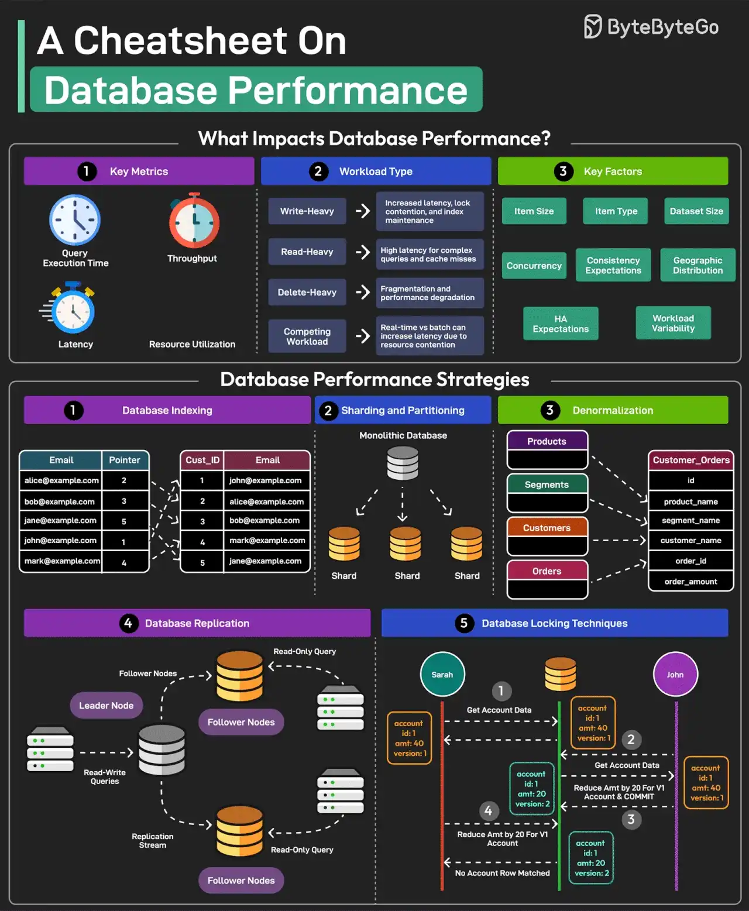

# 020 - A Cheatsheet on Database Performance

- Source: ByteByteGo Big Archive System Design 2025
- PDF pages: 46-47
- Figures: 1

## Figures

## Original Extracted Text

Good database performance is critical since it directly impacts user experience, operational costs,
and scalability.

But what impacts database performance?

Evaluating database performance depends on key metrics such as query execution time,
throughput, latency, and resource utilization.

Workload Types such as write-heavy, read-heavy, delete-heavy, and competing workloads pose
unique challenges.

Other factors that impact performance are item size, item type, dataset size, concurrency
expectations, consistency requirements, HA expectations, and geographic distribution.

Multiple strategies exist to improve database performance. Some of the most important ones are as
follows:

   1. Database Indexing
       Indexes are important for speeding up database queries by reducing the amount of data
       scanned. Also, choosing the right index type is crucial.

   2. Sharding and Partitioning
       Divide the data into smaller, more manageable chunks known as shards. Each shard is also
       stored on a different server.

   3. Denormalization
       Denormalization combines data into fewer tables to reduce the overhead of joins, improving
       read performance.

   4. Database Replication
       Replication involves maintaining multiple copies of the same database, typically with a
       primary node for writes (and critical reads) and secondary nodes for most read operations.

   5. Database Locking Techniques
       Use locking techniques like pessimistic and optimistic locking to manage concurrency levels
       and resource contention.

Over to you: Which other database performance strategy will you add to the list?
