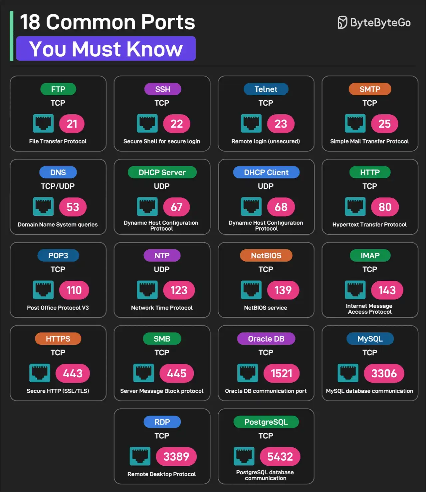

# 021 - 18 Common Ports Worth Knowing

- Source: ByteByteGo Big Archive System Design 2025
- PDF pages: 48-49
- Figures: 1

## Figures

## Original Extracted Text

1. FTP (File Transfer Protocol): Uses TCP Port 21

 2. SSH (Secure Sheel for Login): Uses TCP Port 22

 3. Telnet: Uses TCP Port 23 for remote login

 4. SMTP (Simple Mail Transfer Protocol): Uses TCP Port 25

 5. DNS: Uses UDP or TCP on Port 53 for DNS queries

    6. DHCP Server: Uses UDP Port 67

    7. DHCTP Client: Uses UDP Port 68

    8. HTTP (Hypertext Transfer Protocol): Uses TCP Port 80

    9. POP3 (Post Office Protocol V3): Uses TCP Port 110

    10.NTP (Network Time Protocol): Uses UDP Port 123

    11. NetBIOS: Uses TCP Port 139 for NetBIOS service

    12.IMAP (Internet Message Access Protocol): Uses TCP Port 139

    13.HTTPS (Secure HTTP): Uses TCP Port 443

    14.SMB (Server Message Block): Uses TCP Port 445

    15.Oracle DB: Uses TCP Port 1521 for Oracle database communication port

    16.MySQL: Uses TCP Port 3360 for MySQL database communication port

    17.RDP: Uses TCP Port 3389 for Remote Desktop Protocol

    18.PostgreSQL: Uses TCP Port 5432 for PostgreSQL database communication

Over to you: Which other port will you add to the list?
