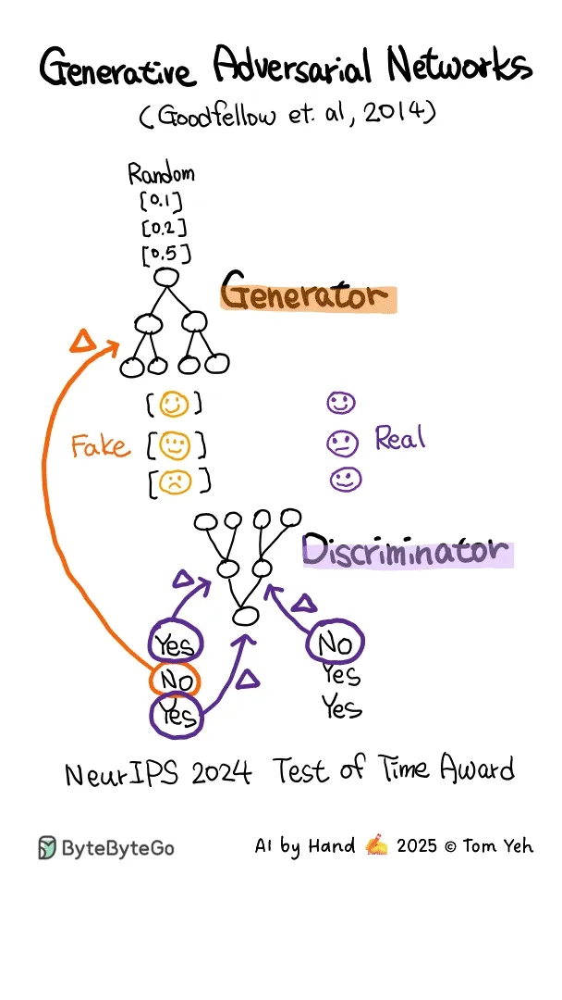

# 022 - Generative Adversarial Network (GAN) - AI by Hand

- Source: ByteByteGo Big Archive System Design 2025
- PDF pages: 50-50
- Figures: 1

## Figures

## Original Extracted Text

✍️
Generative Adversarial Network (GAN) - AI by Hand

This animation is hand drawn by Prof. Tom Yeh exclusively for the readers of the ByteByteGo
Newsletter..

If you want to learn more about GAN, check out Chapter 7 in the System Design Interview book.
