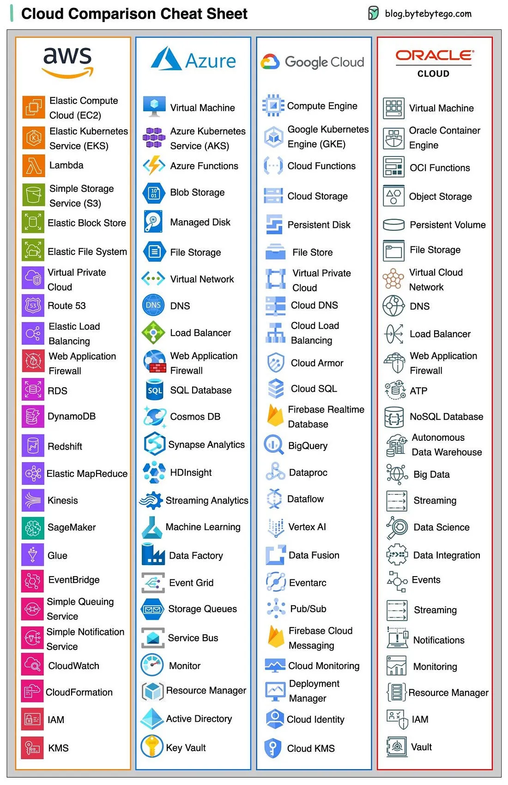

# 024 - A handy cheat sheet for the most popular cloud services

- Source: ByteByteGo Big Archive System Design 2025
- PDF pages: 53-54
- Figures: 1

## Figures

## Original Extracted Text

What's included?

   ● AWS, Azure, Google Cloud, Oracle Cloud, Alibaba Cloud

   ● Cloud servers

   ● Databases

   ● Message queues and streaming platforms

   ● Load balancing, DNS routing software

   ● Security

   ● Monitoring

Over to you - which company is the best at naming things?
