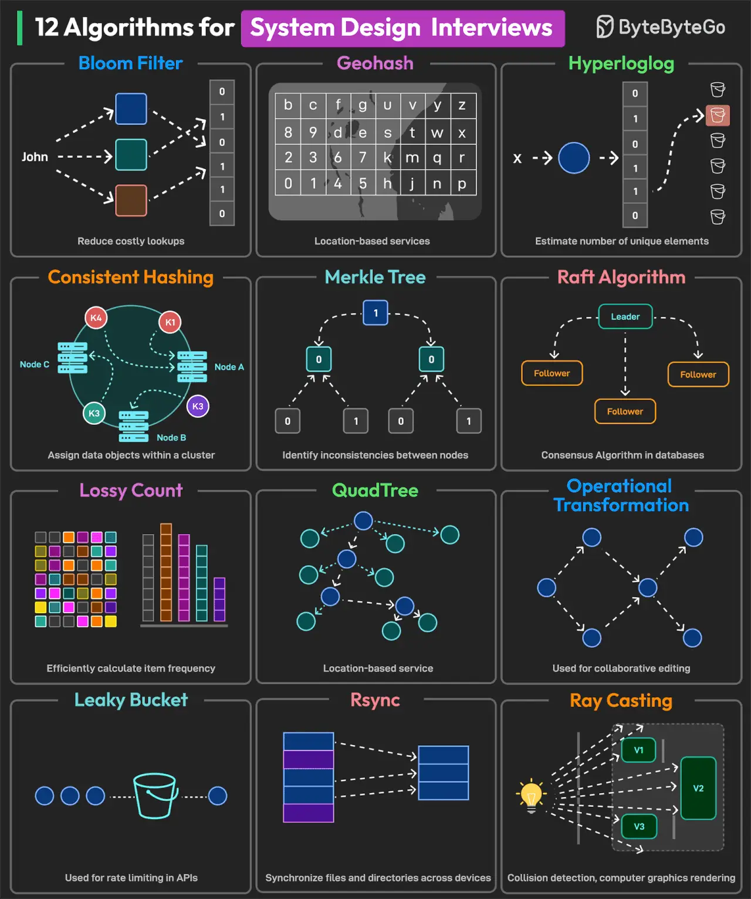

# 027 - 12 Algorithms for System Design Interviews

- Source: ByteByteGo Big Archive System Design 2025
- PDF pages: 59-60
- Figures: 1

## Figures

## Original Extracted Text

1. Bloom Filter: Check if a requested item is in the cache before performing disk operations.

 2. Geohash: Used to build location-based services.

 3. HyperLogLog: Counting unique queries performed by users in a search.

 4. Consistent Hashing: Used for efficient data distribution between the cluster's nodes.

 5. Merkle Tree: Used to detect inconsistencies between data replicas across multiple nodes.

   6. Raft Algorithm: Used to achieve consensus on log replication.

   7. Lossy Count: Network traffic analysis, web analytics, and identifying heavy hitters.

   8. QuadTree: Used to build location-based services.

   9. Operational Transformation: Used to support collaborative editing systems.

   10.Leaky Bucket: Used for rate limiting

   11. Rsync: Synchronizing files and directories between two different systems.

   12.Ray Casting: Used for geospatial analysis, collision detection in video games, and computer
       graphics.

Over to you: Which other algorithm will you add to the list?
