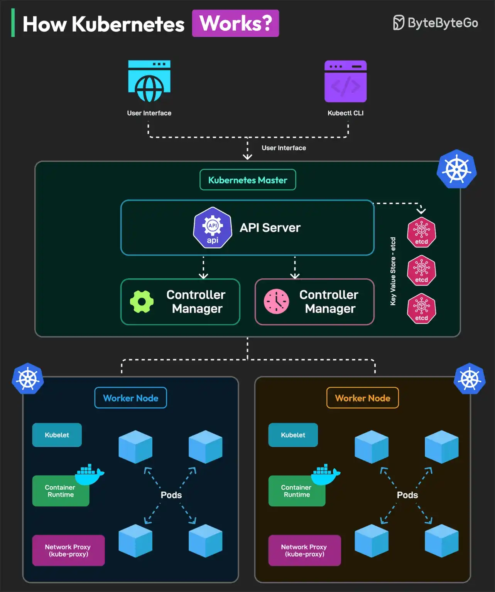

# 028 - How Kubernetes Works?

- Source: ByteByteGo Big Archive System Design 2025
- PDF pages: 61-62
- Figures: 1

## Figures

## Original Extracted Text

Kubernetes (K8S) is an open-source container orchestration platform originally developed by Google
and now maintained by the Cloud Native Computing Foundation (CNCF).

Here's how developers interact with Kubernetes:

   1. Developers create manifest files describing the application.

   2. Kubernetes takes these manifest files, validates them, and deploys the applications across
       its cluster of worker nodes.

   3. Kubernetes manages the entire lifecycle of the application.

Kubernetes is made up of two main components:

   1. Control Plane: It is like the brain of Kubernetes and consists of the following parts:

           ○ API Server: It receives all incoming requests from users or CLI.

           ○ Scheduler: It decides where to run new pods based on resource availability and
              constraints.

           ○ Controller Manager: It ensures that the cluster's desired state matches the actual
              state.

           ○ Etcd: The key-value store where Kubernetes keeps all of its data, including
              configurations, cluster states, and desired states of applications.

   2. Worker Nodes: They are the workers in a cluster. Each node has the below sub-components:

           ○ Kubelet: Main worker on each node. It communicates with the API server, gets
              instructions, and ensures that the containers are running as expected.

           ○ Kube-proxy: Handles networking on each node.

           ○ Container runtime

Over to you: Have you used Kubernetes for your projects?
