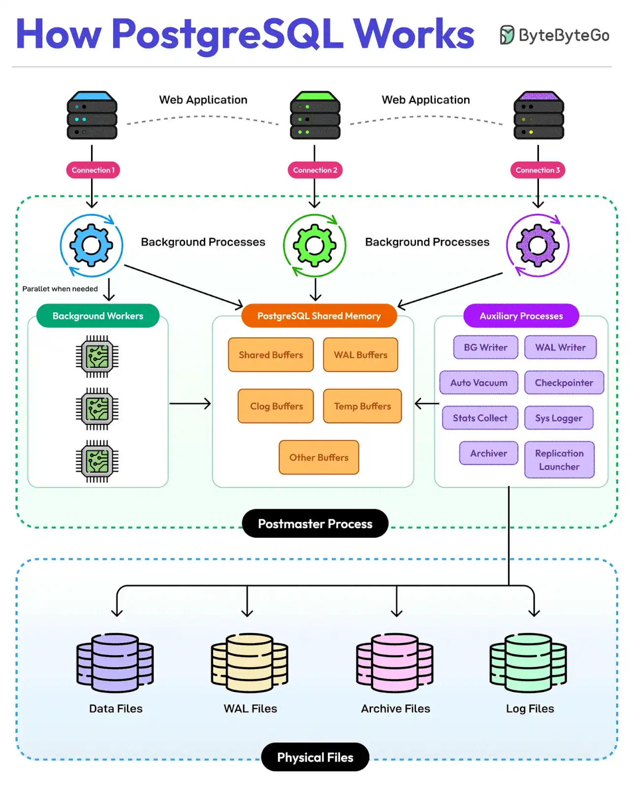

# 029 - PostgreSQL 101: The Everything Database

- Source: ByteByteGo Big Archive System Design 2025
- PDF pages: 63-64
- Figures: 1

## Figures

## Original Extracted Text

Built using C language, PostgreSQL is the most popular choice of database from small web apps to
enterprise systems. It runs as a multiprocess system and follows ACID principles.

The key points about PostgreSQL's Architecture are as follows:

   1. PostgreSQL supports concurrent client connections independently. Each client connection to
       PostgreSQL creates a dedicated server process.

   2. The Postmaster Process is the main supervisor that manages all other PostgreSQL
       processes. It controls the entire database instance.

   3. Background workers run parallel processes when needed to handle specialized tasks.

   4. PostgreSQL shared memory is a central memory area containing multiple buffers such as
       Shared, WAL, Clog, and Temporary buffers. All components communicate through this
       shared memory.

   5. PostgreSQL also has several auxiliary processes such as:

           ○ BG Writer: Manages background writing

           ○ WAL Writer: Handles write-ahead logging

           ○ Auto Vacuum: Maintains database cleanliness

           ○ Checkpointer: Ensures data consistency

           ○ Stats Collector: Gathers statistics

           ○ System Logger: Manages Logging

           ○ Archiver: Handles archiving

           ○ Replication launcher: Manages replication

   6. PostgreSQL has different types of physical files for varied needs such as:

           ○ Data Files: Stores actual database data

           ○ WAL Files: Write-ahead log storage

           ○ Archive Files: Backup and recovery data

           ○ Log Files: System and error logs

Over to you: What else would you add to understand more about PostgreSQL's architecture?
