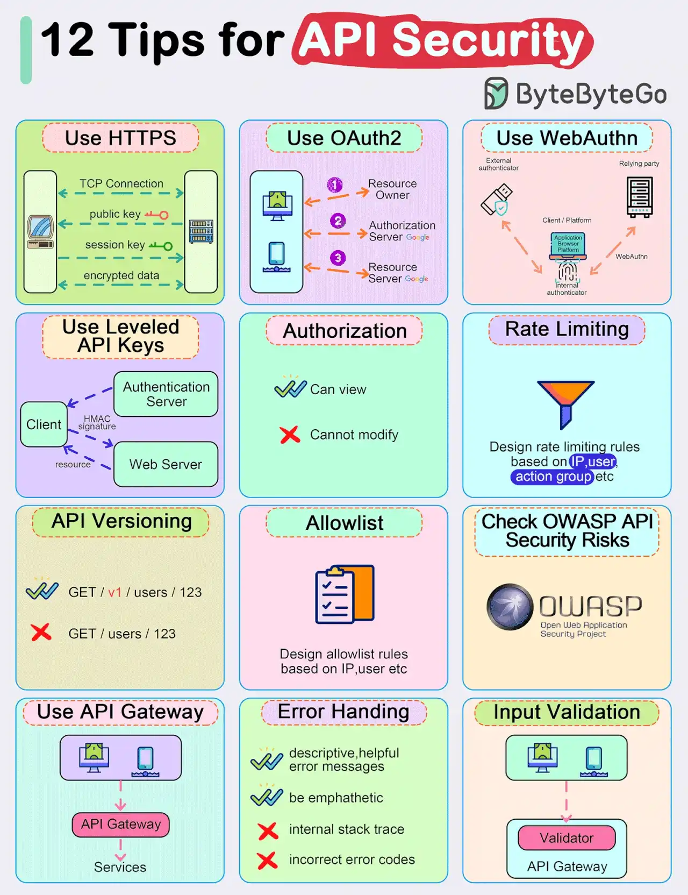

# 030 - Top 12 Tips for API Security

- Source: ByteByteGo Big Archive System Design 2025
- PDF pages: 65-66
- Figures: 1

## Figures

## Original Extracted Text

● Use HTTPS

  ● Use OAuth2

  ● Use WebAuthn

  ● Use Leveled API Keys

● Authorization

● Rate Limiting

● API Versioning

● Whitelisting

● Check OWASP API Security Risks

● Use API Gateway

● Error Handling

● Input Validation
