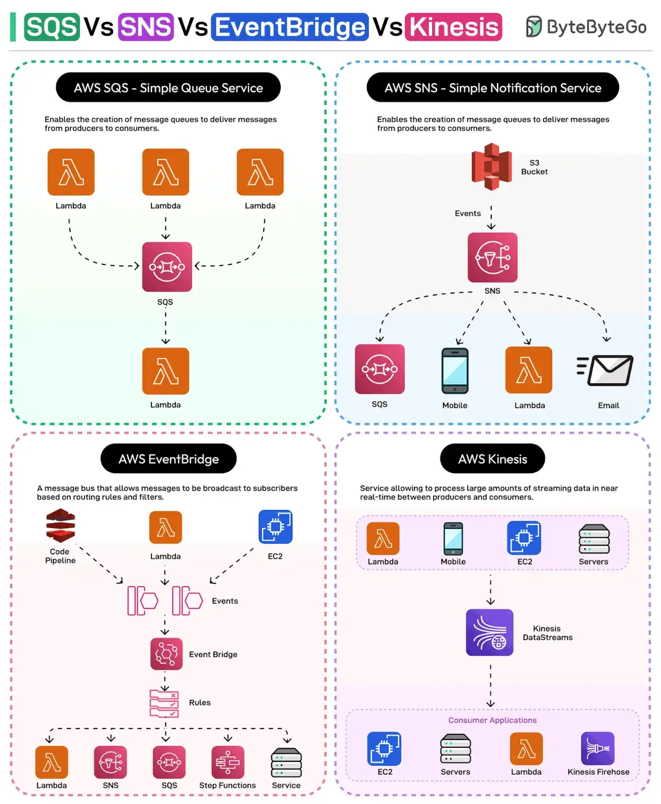

# 032 - SQS vs SNS vs EventBridge vs Kinesis

- Source: ByteByteGo Big Archive System Design 2025
- PDF pages: 69-70
- Figures: 1

## Figures

## Original Extracted Text

1. AWS SQS: It is a fully managed message queuing service that helps decouple
     communication between distributed components.

 2. AWS SNS: A fully managed publish/subscribe messaging service using topics to send
     messages to multiple subscribers or endpoints (such as email, Lambda, SQS, and so on).

 3. AWS EventBridge: It is a serverless event bus that facilitates the routing of events between
     AWS services, and applications based on specific routing rules and filters.

   4. AWS Kinesis Data Streams: A real-time data streaming service that captures, processes,
       and analyzes data in near real-time.

How can you choose which service to use?

Here are some basic tips and examples:

   ● For massive amounts of events like a clickstream from an application use Kinesis Data
      Stream

   ● For events processed by a single consumer like an image processing job, SQS is a better
      choice.

   ● For sending messages and notifications, SNS is a great choice.

   ● For system events such as a new user registration that multiple services must receive and
      react to, use EventBridge.

Over to you: Have you used SQS, SNS, EventBridge, or Kinesis?
