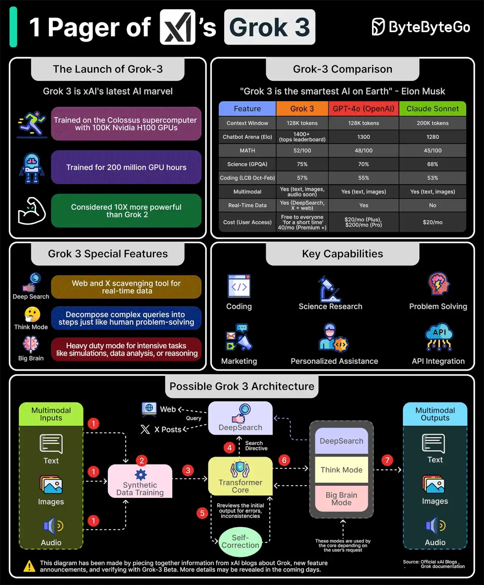

# 034 - xAI's Grok-3 One-Pager

- Source: ByteByteGo Big Archive System Design 2025
- PDF pages: 73-74
- Figures: 1

## Figures

## Original Extracted Text

Grok 3 was unveiled on February 17. According to Elon Musk, it is "the smartest AI on Earth."

But what makes it so powerful?

Grok 3 has been trained on the Colossus supercomputer with 100K Nvidia H100 GPUs. According
to one stat, it has been trained for 200 million GPU hours. The key capabilities of Grok 3 are coding,
science research, problem-solving, creating marketing campaigns, personalized assistance, and API
integration.

Some special features of Grok 3 are:

   1. DeepSearch: Allows Grok to search the web and X posts for real-time data and information.

   2. Think Mode: Decompose complex queries into steps just like human problem-solving.

   3. Big Brain Mode: A heavy-duty mode for intensive tasks like simulations, data analysis, or
       reasoning.

Here's how Grok 3 possibly works:

   1. Grok 3 supports multi-modal inputs. The user can ask questions as text, upload images, or
       talk to Grok. The inputs are tokenized to initiate processing.

   2. Synthetic data training enhances the query interpretation.

   3. This is fed to the core transformer model that analyzes the input.

   4. The core transformer issues a search directive to DeepSearch to retrieve necessary
       information from the web or real-time X data.

   5. Next, a self-correct process ensures accuracy through an internal feedback loop.

   6. Depending on the user's input, the Think Mode or Big Brain Mode refines the responses as
       required. It might again use DeepSearch to find more information.

   7. The answers are delivered to the user in a multimodal manner.

Note that these details are based on piecing together information from xAI blogs about Grok and
new feature announcements. More details may be revealed in the coming days.

Over to you: Have you used xAI's Grok 3?
