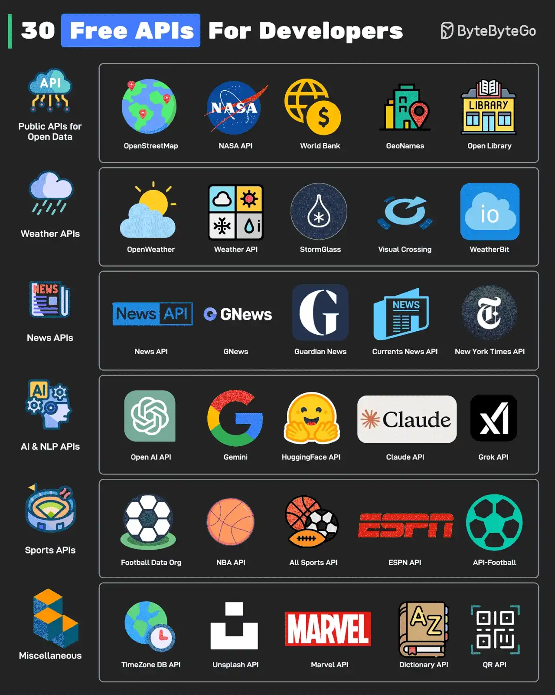

# 035 - 30 Free APIs for Developers

- Source: ByteByteGo Big Archive System Design 2025
- PDF pages: 75-76
- Figures: 1

## Figures

## Original Extracted Text

APIs are the backbone of modern software development. Whether it is a hobby project or a
real-world application, developers need APIs. These APIs (some completely free and some with
free tiers) can help kickstart development.

   1. Public APIs for Open Data
       OpenStreetMap, NASA, World Bank, GeoNames, and Open Library APIs provide a lot of
       useful data.

   2. Weather APIs
       OpenWeather, Weather API, StormGlass, Visual Crossing, and WeatherBit are some APIs to
       fetch weather-related information

   3. News APIs
       The News API, GNews, Guardian News, Current News API, and New York Times API can
       help developers fetch the latest news.

   4. AI & NLP APIs
       Open AI API, Gemini, HugginFace API, Claude API, and Grok API can help developers
       experiment with AI models and tools.

   5. Sports API
       Football Data Org, NBA API, All Sports API, ESPN API, and API-Football can help fetch
       sports-related information.

   6. Miscellaneous
       Some interesting miscellaneous APIs are TimeZone API, Unsplash API, Marvel API,
       Dictionary API, and QR Generation API.

Over to you: Which other API will you add to the list?
