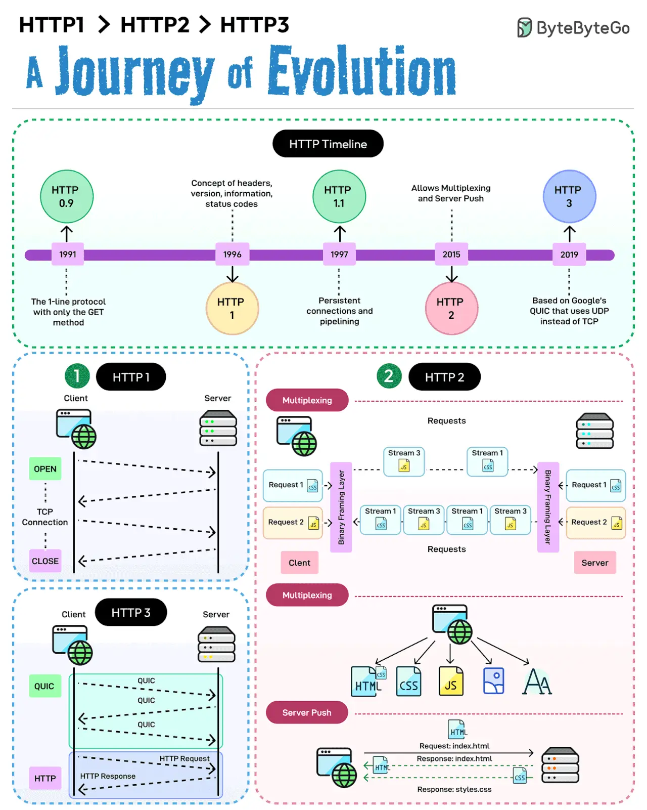

# 037 - HTTP/1 -> HTTP/2 -> HTTP/3

- Source: ByteByteGo Big Archive System Design 2025
- PDF pages: 79-80
- Figures: 1

## Figures

## Original Extracted Text

HTTP 1 started in 1996 followed by HTTP 1.1 the very next year. In 2015, HTTP 2 came about and
in 2019 we got HTTP 3.

With each iteration, the protocol has evolved in new and interesting ways.

1 - HTTP 1 (and its sub-versions) introduced features like persistent connections, pipelining, and the
concept of headers. The protocol was built on top of TCP and provided a reliable way of
communication over the World Wide Web. It is still used despite being over 25 years old.

2 - HTTP 2 brought new features such as multiplexing, stream prioritization, server push, and
HPACK compression. However, it still used TCP as the underlying protocol.

3 - HTTP 3 uses Google's QUIC, which is built on top of UDP. In other words, HTTP 3 has moved
away from TCP.

Over to you: What would you add to understand the evolution of HTTP over the years?
