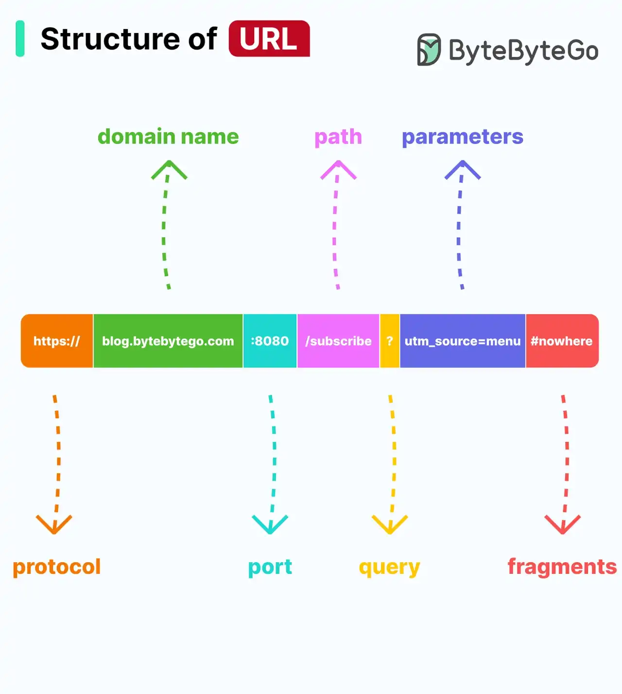

# 038 - Structure of URL

- Source: ByteByteGo Big Archive System Design 2025
- PDF pages: 81-82
- Figures: 1

## Figures

## Original Extracted Text

Do you know all the components of a URL?

Uniform Resource Locator (URL) is a term familiar to most people, as it is used to locate resources
on the internet. When you type a URL into a web browser's address bar, you are accessing a
"resource", not just a webpage.

URLs comprise several components:

   ● The protocol or scheme, such as http, https, and ftp.

   ● The domain name and port, separated by a period (.)

   ● The path to the resource, separated by a slash (/)

● The parameters, which start with a question mark (?) and consist of key-value pairs, such as
   a=b&c=d.

● The fragment or anchor, indicated by a pound sign (#), which is used to bookmark a specific
   section of the resource.
