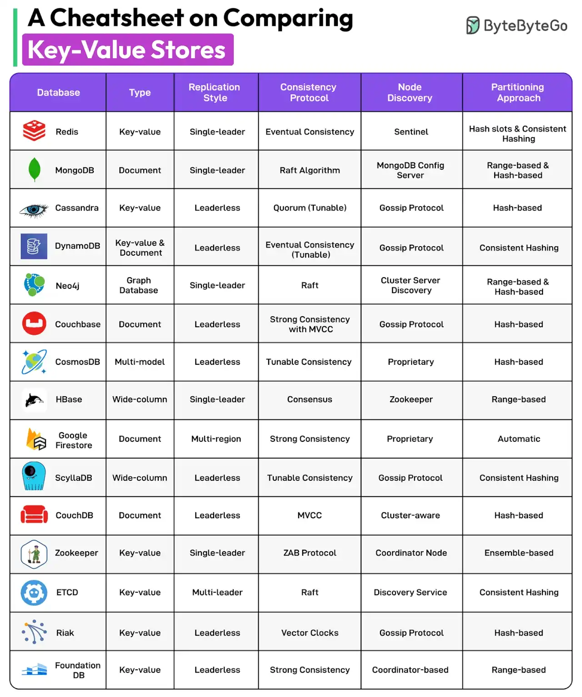

# 039 - A Cheatsheet on Comparing Key-Value Stores

- Source: ByteByteGo Big Archive System Design 2025
- PDF pages: 83-84
- Figures: 1

## Figures

## Original Extracted Text

A key-value store is a database that stores data as a collection of key-value pairs. We compare 15
key-value stores across different parameters like replication style, consistency protocol, node
discovery approach, and partitioning approach.

The databases covered are:

   1. Redis

   2. MongoDB

   3. Cassandra

   4. DynamoDB

   5. Neo4j

   6. Couchbase

   7. CosmosDB

   8. HBase

   9. Firestore

   10.ScyllaDB

   11. CouchDB

   12.Zookeeper

   13.ETCD

   14.Riak

   15.FoundationDB

Over to you: Which other database will you add to the list?
