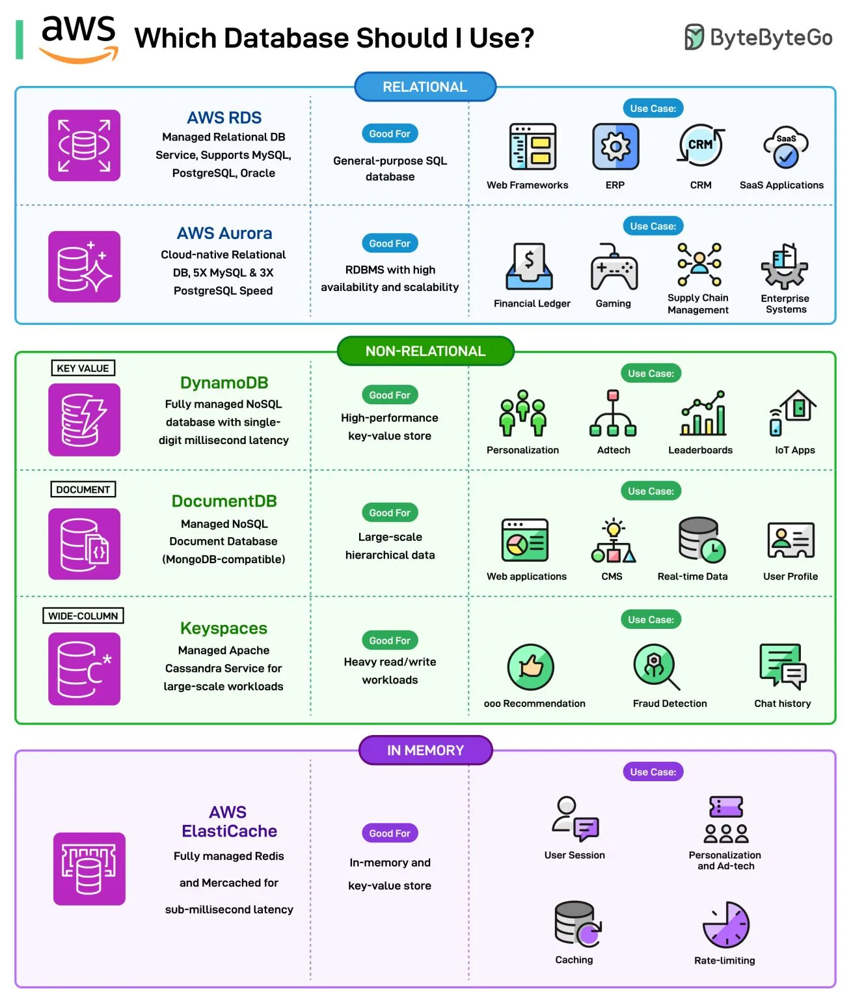

# 040 - Which Database Should I Use on AWS?

- Source: ByteByteGo Big Archive System Design 2025
- PDF pages: 85-86
- Figures: 1

## Figures

## Original Extracted Text

This question often comes up when we start deploying an application on AWS. There are many
options available to choose from.

Broadly, there are three categories of databases:

   1. Relational
       The two main choices in this space are AWS RDS and AWS Aurora.

       AWS RDS is a managed relational DB service that supports MySQL, PostgreSQL, Oracle,
       etc. AWS Aurora is a cloud-native relational database that supports high availability and
       scalability

   2. Non-Relational
       The three main choices in this category are DynamoDB, DocumentDB, and AWS

      Keyspaces.

      DynamoDB is a fully managed NoSQL key-value datastore. DocumentDB is a managed
      document database compatible with MongoDB. AWS Keyspaces is a managed, wide-column
      Apache Cassandra service for large-scale workloads.

   3. In-memory
       AWS Elasticache is the most popular option in this category. It is a fully managed Redis or
       Memcached service for sub-millisecond latency.

Over to you: Which AWS Databases have you used?
