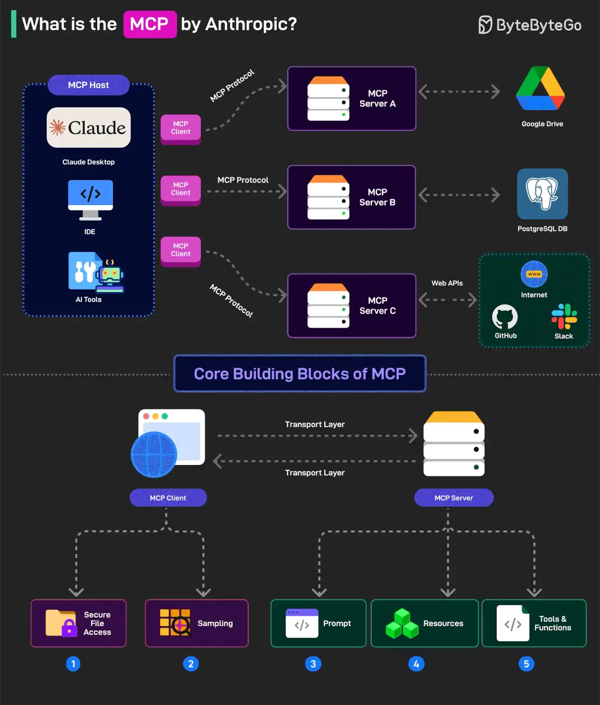

# 041 - What is MCP?

- Source: ByteByteGo Big Archive System Design 2025
- PDF pages: 87-88
- Figures: 1

## Figures

## Original Extracted Text

Why is everyone talking about it? Let's take a closer look.

Model Context Protocol (MCP) is a new system introduced by Anthropic to make AI models more
powerful.

It is an open standard (also being run as an open-source project) that allows AI models (like Claude)
to connect to databases, APIs, file systems, and other tools without needing custom code for each
new integration.

MCP follows a client-server model with 3 key components:

   1. Host: AI applications like Claude that provide the environment for AI interactions so that
       different tools and data sources can be accessed. The host runs the MCP Client.

   2. MCP Client: The MCP client is the component inside an AI model (like Claude) that allows it
       to communicate with MCP servers. For example, if the AI model wants data from
       PostgreSQL, the MCP client formats the request into a structured message to send to the
       MCP Server

   3. MCP Server: This is the middleman that connects an AI model to an external system like
       PostgreSQL, Google Drive, or an API. For example, if Claude analyzes sales data from
       PostgreSQL, the MCP Server for PostgreSQL acts as the connector between Claude and
       the database.

MCP has five core building blocks (also known as primitives). They are divided between the client
and server.

   1. For the clients, the building blocks are Roots (secure file access) and Sampling (ask the AI
       for help with a task such as generating a DB query).

   2. For the servers, there are Prompts (instructions to guide the AI), Resources (Data Objects
       that the AI can reference) and Tools (functions that the AI can call such as running a DB
       query).

Over to you: Have you explored Anthropic's Model Context Protocol?
