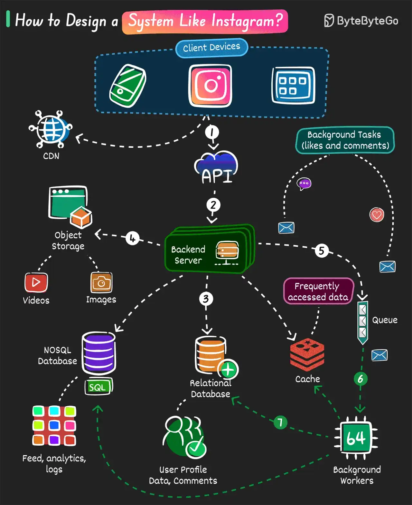

# 042 - How to Design a System like Instagram

- Source: ByteByteGo Big Archive System Design 2025
- PDF pages: 89-90
- Figures: 1

## Figures

## Original Extracted Text

Here's a simple step-by-step approach to build the core functionality:

   1. Users perform an action on their device like tapping the like button, uploading a picture, or
       following another user.

   2. The request goes through a gateway to the backend server built using frameworks like
       Django, Express, or anything else.

   3. The data is stored in the database.

           ○ Structured data such as user profiles, comments, and relationships are stored in
              relational databases like Postgres.

           ○ Data items requiring high write throughput such as user feeds and activity logs can
              be stored in eventually consistent databases like Cassandra.

           ○ Frequently accessed data is stored in cache (for example, Redis or Memcached).

   4. Images and videos are stored in an object storage and corresponding metadata is stored in
       the database.

   5. Asynchronous tasks like sending notifications are sent to a queue.

   6. Background workers (like Celery) retrieve the task from the queue and perform the
       necessary processing.

   7. Celery worker also performs the necessary updates in the databases.

Over to you: What else will you add to build an Instagram-like system?
