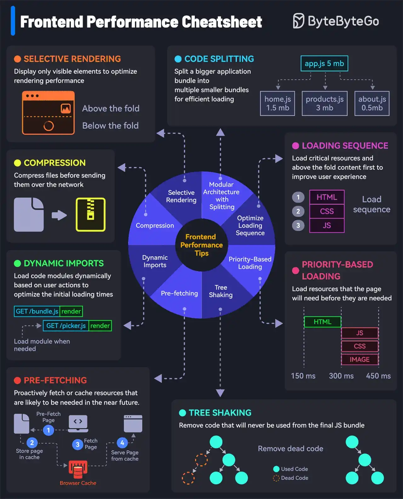

# 043 - How to load your websites at lightning speed

- Source: ByteByteGo Big Archive System Design 2025
- PDF pages: 91-92
- Figures: 1

## Figures

## Original Extracted Text

Check out these 8 tips to boost frontend performance:

   1. Compression
       Compress files and minimize data size before transmission to reduce network load.

   2. Selective Rendering/Windowing
       Display only visible elements to optimize rendering performance. For example, in a dynamic
       list, only render visible items.

   3. Modular Architecture with Code Splitting
       Split a bigger application bundle into multiple smaller bundles for efficient loading.

   4. Priority-Based Loading
       Prioritize essential resources and visible (or above-the-fold) content for a better user
       experience.

   5. Pre-loading
       Fetch resources in advance before they are requested to improve loading speed.

   6. Tree Shaking or Dead Code Removal
       Optimize the final JS bundle by removing dead code that will never be used.

   7. Pre-fetching
       Proactively fetch or cache resources that are likely to be needed soon.

   8. Dynamic Imports
       Load code modules dynamically based on user actions to optimize the initial loading times.

Over to you: What other frontend performance tips would you add to this cheat sheet?
