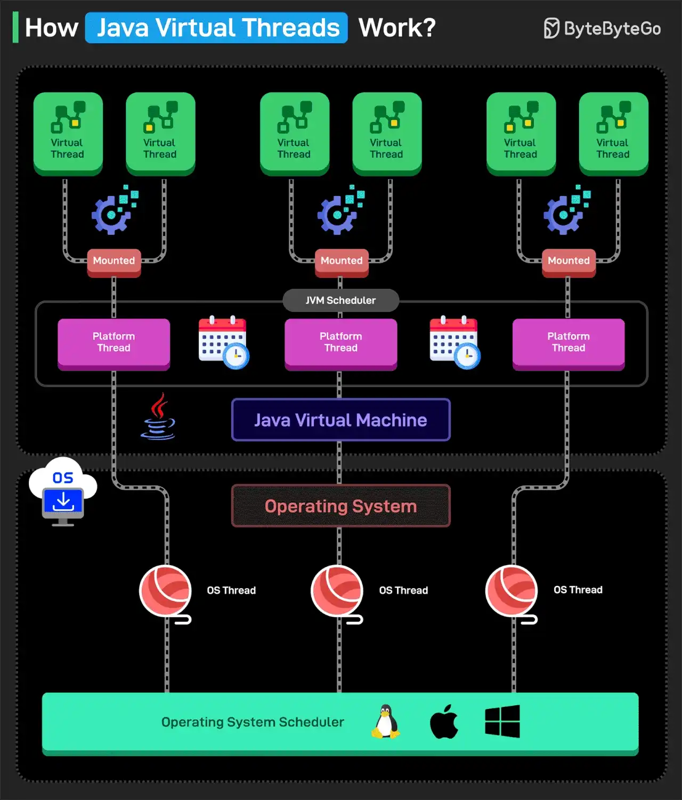

# 045 - How Java Virtual Threads Work?

- Source: ByteByteGo Big Archive System Design 2025
- PDF pages: 95-96
- Figures: 1

## Figures

## Original Extracted Text

Virtual Threads are lightweight threads introduced in Java 19 (Preview) and Java 21 (Stable). They
allow Java to create millions of threads efficiently, helping handle concurrent tasks without wasting
memory or CPU.

Virtual Threads do not map 1:1 to OS Threads and do not replace the original Platform Threads. The
Platform Threads are backed by the OS Threads and are sometimes also known as Carrier Threads
in this context.
Think of the Platform Threads as a small group of workers, and Virtual threads as tasks. With Virtual
threads, tasks are given to workers only when needed, allowing one worker to handle thousands of
tasks efficiently.
Here's how Virtual Threads work:

   1. Virtual Threads run on top of Platform Threads. The JVM schedules them onto a small
       number of Platform Threads.

   2. When a Virtual Thread starts, the JVM assigns it to a normal OS-backed Platform Thread.

   3. Virtual Threads can also handle CPU-intensive work, but their real advantage is in scenarios
       with a high number of I/O-bound or concurrent tasks.

   4. If the Virtual Thread performs a blocking operation (like I/O, database call, sleep, etc.), the
       JVM unmounts it from the Platform Thread. However, this does not block the underlying OS
       Thread as such.

   5. The Platform thread is freed up to handle another Virtual Thread.

   6. When the blocking operation finishes, the Virtual Thread is rescheduled on any available
       Platform thread.

Over to you: Have you used Virtual Threads?
