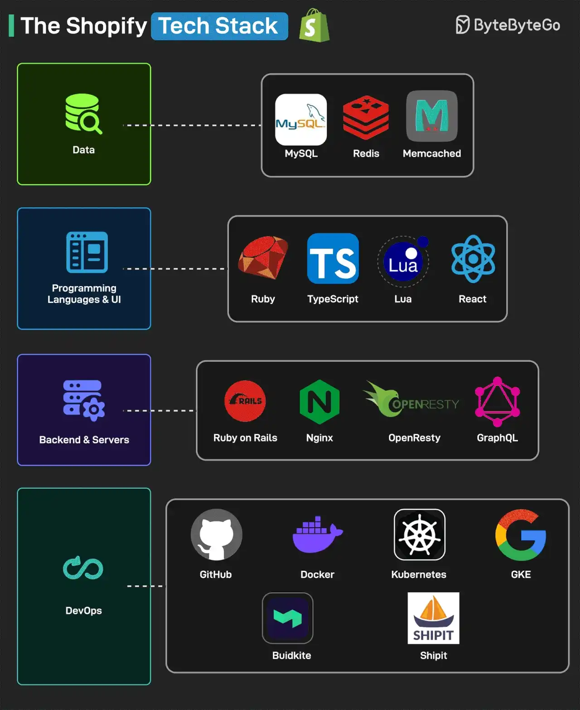

# 047 - The Shopify Tech Stack

- Source: ByteByteGo Big Archive System Design 2025
- PDF pages: 98-99
- Figures: 1

## Figures

## Original Extracted Text

Shopify is a multi-channel commerce platform for small and medium businesses. It allows merchants
to create a shop and sell products wherever they want.

Here's the Shopify Tech Stack, which powers more than 600,000 merchants and serves 80,000
requests per second during peak traffic.

   1. Programming Languages & UI: They use Ruby, Typescript, Lua, and React

   2. Backend & Servers: They use Ruby on Rails, Nginx, OpenResty, and GraphQL.

   3. Data: They use MySQL, Redis, and Memcached.

   4. DevOps: They use GitHub, Docker, Kubernetes, GKE, BuildKite, and ShipIt. ShipIt has been
       also made open source.

Reference: E-Commerce at Scale: Inside Shopify's Tech Stack
