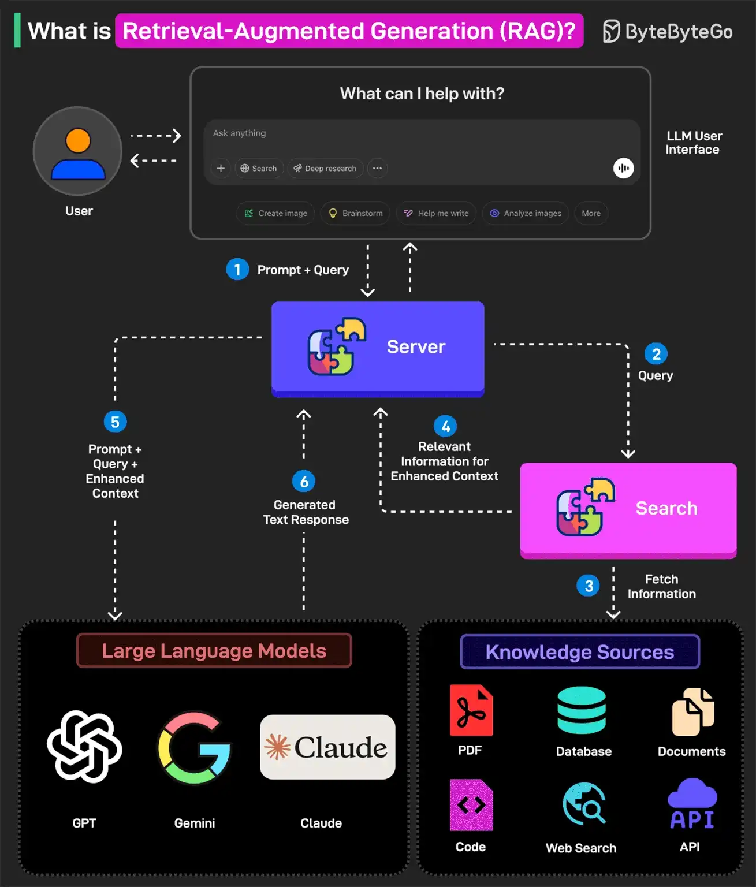

# 049 - What is Retrieval-Augmented Generation (RAG)?

- Source: ByteByteGo Big Archive System Design 2025
- PDF pages: 102-103
- Figures: 1

## Figures

## Original Extracted Text

RAG is the process of optimizing an LLM's output to reference a specific knowledge base that may
not have been part of its training data before generating a response.

In other words, RAG helps extend the powerful capabilities of LLMs to specific domains or
knowledge bases without the need for additional training.

Here's how RAG works:

   1. The user writes a query prompt in the LLM's user interface. This query is passed to the
       backend server where it is converted to a vector representation.

   2. The query is sent to a search system.
   3. This search system can refer to various knowledge sources such as PDFs, Web Search,
       Code-bases, Documents, Database, or APIs to fetch relevant information to answer the
       query.
   4. The fetched information is sent back to the RAG model.
   5. The model augments the original user input by adding the fetched information to the context
       and sending it to the LLM endpoint. Various LLM options are Open AI's GPT, Claude Sonnet,
       Google Gemini, and so on.
   6. The LLM generates an answer based on the enhanced context and provides a response to
       the user.

Over to you: Have you used RAG with your favorite LLM?
