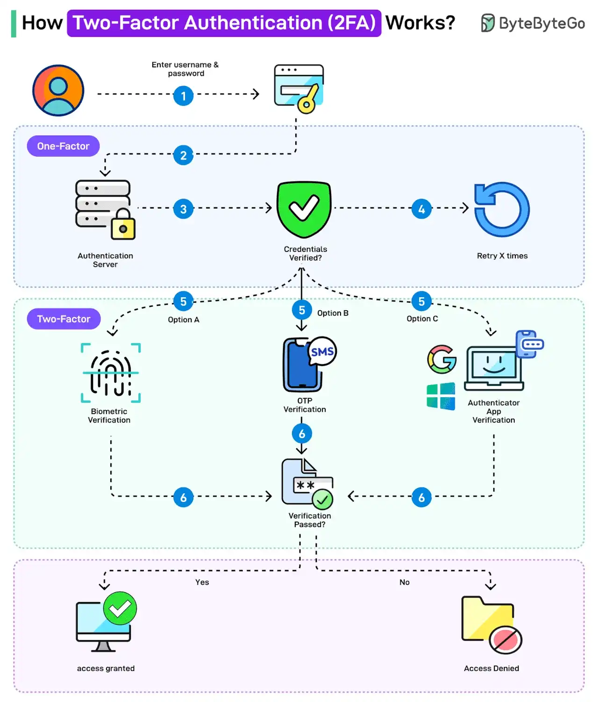

# 050 - How Two-factor Authentication (2FA) Works?

- Source: ByteByteGo Big Archive System Design 2025
- PDF pages: 104-105
- Figures: 1

## Figures

## Original Extracted Text

Two-factor authentication (2FA) is a type of multi-factor authentication that makes accounts more
secure.

The idea behind 2FA is that you need to provide two identifying factors to prove your identity and
gain access to your account.

The first factor is the knowledge factor, where a user needs to know a secret, such as a password.
The second factor depends on the possession factor (such as RSA, authenticator app) or inherence
factor (biometrics).

Here's how 2FA works:

   1. The user enters username and password. This is for the first level of authentication, also
       known as single-factor.

   2. The authentication request goes to the authentication server.

   3. The authentication credentials are verified.

   4. In case of any incorrect credentials, a certain number of retries may be allowed.

   5. If the credentials are correct, the two-factor authentication kicks in. There are multiple
       options available: biometric verification, OTP verification, or Authenticator App Verification.
       Organizations like Google and Microsoft also provide such apps.

   6. The user verifies using the chosen option.

   7. If the verification fails, access is denied. However, if verification succeeds, access is granted.

Note that the OTP verification using SMS is often considered less secure as a 2FA mechanism.

Over to you - Have you used two-factor authentication?
