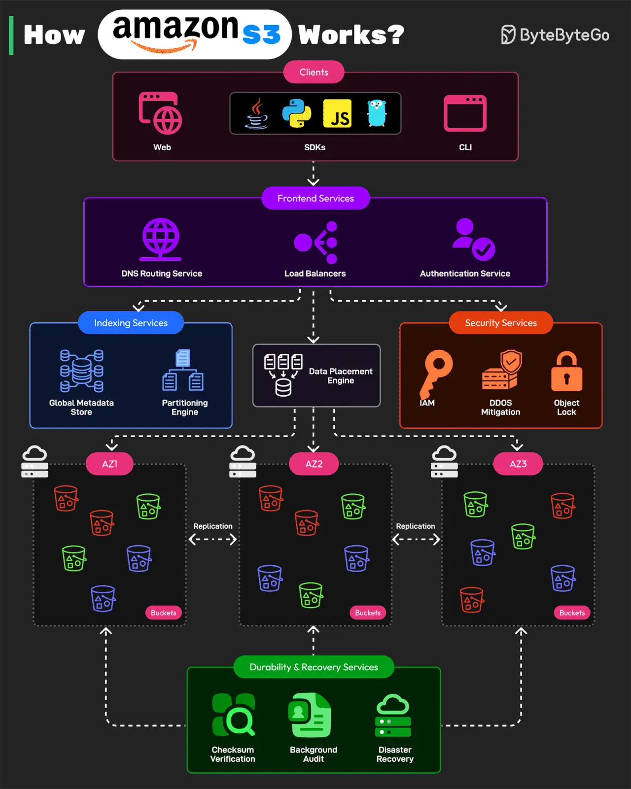

# 051 - How Amazon S3 Works?

- Source: ByteByteGo Big Archive System Design 2025
- PDF pages: 106-107
- Figures: 1

## Figures

## Original Extracted Text

This post is based on:

   1. AWS re:Invent 2023 - Dive deep on Amazon S3 video

   2. Building and operating a pretty big storage system called S3 published on All Things
       Distributed.

Amazon S3 is one of the largest and most complex distributed storage systems in the world. It
processes millions of requests per second and stores over 350 trillion objects while maintaining
99.999999999% durability.

AWS architected S3 using a microservices-based design

Here's how it works:

   1. Front-end Request Handling Services
       These services receive API requests from clients. The clients can be web, CLI, and SDKs for
       programming languages like Java, Python, JS, or Golang. After receiving the request, the
       services authenticate users, validate requests, and route them to the correct storage service.
       The services consist of DNS routing, authentication service, and load balancing.

   2. Indexing and Metadata Services
       Every object stored in S3 is assigned a unique identifier and metadata. The indexing
       services track object locations. They consist of a global metadata store and partitioning
       engine.

   3. Storage and Data Placement Services
       This part handles the physical storage of objects across multiple S3 nodes. To protect
       against data loss, it uses erasure coding and multi-AZ replication.

   4. Durability and Recovery Services
       These services ensure data integrity and fault recovery. They consist of checksum
       verification, background auditing, and disaster recovery.

   5. Security and Compliance Services
       These services protect S3 from unauthorized access and support features such as IAM and
       bucket Policy, DDoS Mitigation, and Object Lockiand versioning.

Over to you: Have you used Amazon S3?
