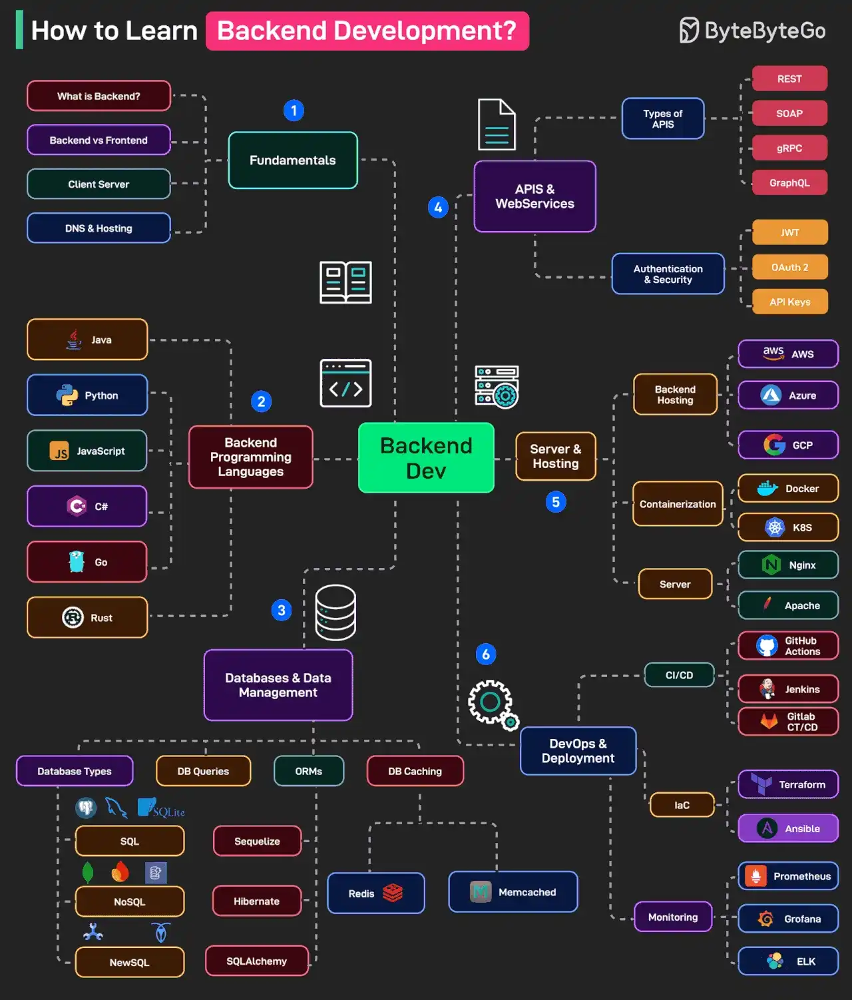

# 052 - How to Learn Backend Development?

- Source: ByteByteGo Big Archive System Design 2025
- PDF pages: 108-109
- Figures: 1

## Figures

## Original Extracted Text

Backend Development requires knowledge of multiple aspects. Here's a mind map of what all things
a developer should learn:

   1. Fundamentals
       This includes topics like backend vs frontend, client-server, DNS, etc.

   2. Backend Programming Languages
       Choose between one or more programming languages like Java, Python, JS, Go, Rust, and
       C#.

   3. Databases
       This includes topics like types of databases such as SQL (Postgres, MySQL, SQLite),
       NoSQL (MongoDB, Firebase, DynamoDB), NewSQL (CockroachDB, Spanner). Other topics
       include working with ORMs and Database Caching.

   4. APIs and Web Services
       Learn about API types (REST, GraphQL, gRPC, SOAP) and authentication techniques (like
       JWT, OAuth 2, API keys).

   5. Server and Hosting
       This involves topics like backend hosting services (AWS, Azure, GCP), Containerization
       using Docker & Kubernetes, and Server Setup for Nginx, Apache, etc.

   6. DevOps
       Learn about CI/CD Pipelines using GitHub Actions and Jenkins, IaC (Terraform, Ansible) and
       Monitoring with tools like Prometheus, Grafana, ELK.

Over to you: What else will you add to the list for learning backend development?
