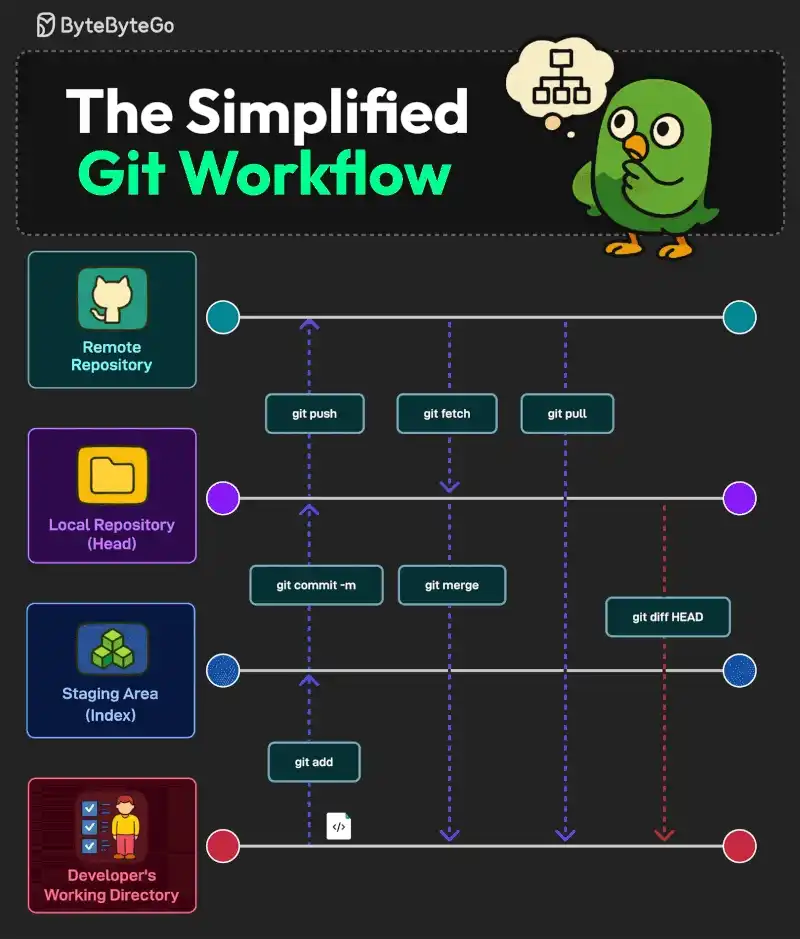

# 053 - A Simplified Git Workflow

- Source: ByteByteGo Big Archive System Design 2025
- PDF pages: 110-111
- Figures: 1

## Figures

## Original Extracted Text

Learning Git is one of the fundamental skills for every developer out there. Here are the steps within
a simple and basic Git workflow.

   1. Developer's Working Directory (Untracked) to Staging Area (Index)
       The command for the same is "git add". The files go from untracked to staged.

   2. Staging Area to Local Repository (Head)
       The command for this move is "git commit -m "message"". It saves changes to the local
       repository (HEAD), marking a version history.

   3. Local Repository to Remote Repository (Remote)
       The command for this move is "git push". It uploads the committed changes to the remote
       repository (such as on GitHub) for collaboration.

   4. Remote Repository to Local Repository
       The commands "git pull" and "git fetch" help with this. "git pull" updates local files with remote
       changes. On the other hand, "git fetch" retrieves remote changes but does not merge them.
       The command "git merge" combines changes from different branches.

   5. Checking the Differences
       The command "git diff HEAD" shows the differences between the developer's working
       directory and the latest commit.

Over to you: Which other step do you follow in your Git workflow?
