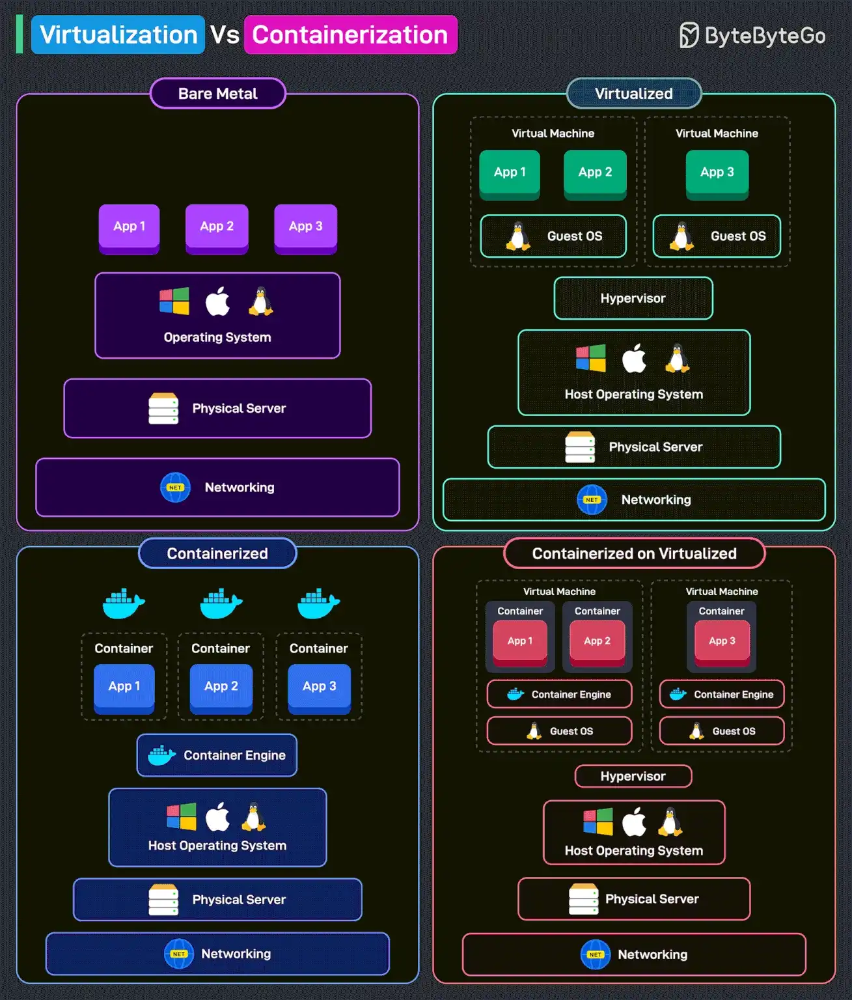

# 054 - Virtualization vs Containerization

- Source: ByteByteGo Big Archive System Design 2025
- PDF pages: 112-113
- Figures: 1

## Figures

## Original Extracted Text

Virtualization creates multiple VMs on a single physical server, each with its operating system, using
a hypervisor.

Containerization is a lightweight virtualization method that runs applications in isolated environments
(containers) sharing the same operating system.

Let's look at the different possibilities in more detail.

    1. Bare Metal: Applications run directly on the operating system. No virtualization or
        containerization is used. It provides high performance but lacks flexibility.

   2. Virtualized: Uses a hypervisor to create VMs. Each VM has its guest OS, making it heavier
       on resources. Provides strong isolation but adds overhead.

   3. Containerized: Uses a container engine instead of a hypervisor. Containers share the host
       operating system, making them lightweight and efficient. It is faster and more scalable than
       VMs.

   4. Containerized on Virtualized: Runs containers inside VMs. Provides both flexibility and
       isolation, common in hybrid cloud environments. It balances resource efficiency with security.

Over to you: Have you used VMs and Containers to deploy workloads?
