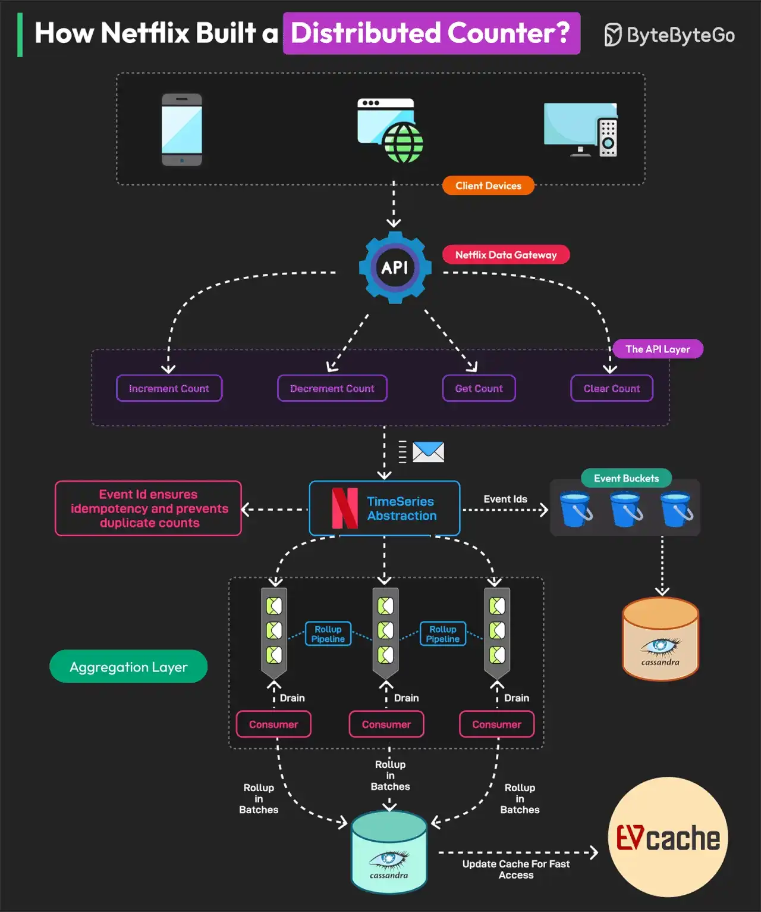

# 055 - How Netflix Built a Distributed Counter?

- Source: ByteByteGo Big Archive System Design 2025
- PDF pages: 114-115
- Figures: 1

## Figures

## Original Extracted Text

A Distributed Counter is a system where the responsibility of counting events is spread across
multiple servers or nodes in a network. Netflix needs to track and measure multiple user interactions
to make real-time decisions and optimize its infrastructure.

For this reason, they built a Distributed Counter Abstraction.

Netflix's Distributed Counter Abstraction operates in four main layers, ensuring high performance,
scalability, and eventual consistency.

    1. Client API Layer
        Users interact with the system by sending AddCount, GetCount, or ClearCount requests.
        The Netflix Data Gateway efficiently processes and routes these requests.

2. Event Logging and TimeSeries Storage
    Events are stored in Netflix TimeSeries Abstraction for scalability. Each event is tagged with
    an Event ID to ensure idempotency. To avoid database contention, events are grouped into
    time partitions known as buckets. Data is stored in Cassandra.

3. Rollup Pipeline or Aggregation
    Rollup Queues collect event changes and process them in batches. Aggregation occurs in
    immutable time windows, ensuring accurate rollup calculations. Data is stored in the
    Cassandra Rollup Store for eventual consistency.

4. Read Optimization (Cache & Query Handling)
    Aggregated counter values are cached in EVCache for ultra-fast reads. If a cache value is
    stale, a background rollup refresh updates it. This model allows Netflix to process 75K
    requests per second with single-digit millisecond latency.
