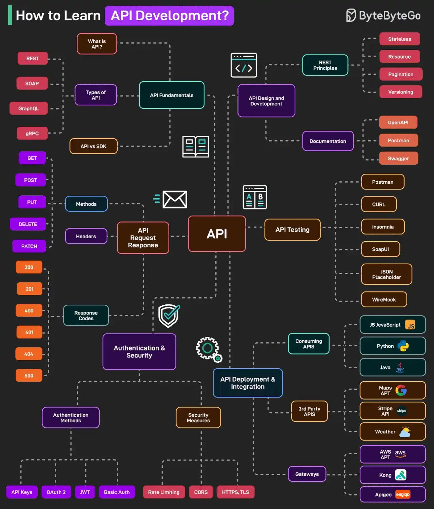

# 056 - How to Learn API Development?

- Source: ByteByteGo Big Archive System Design 2025
- PDF pages: 116-117
- Figures: 1

## Figures

## Original Extracted Text

Learning how to develop APIs is an important skill for modern-day developers. Here's a mind map of
what all you need to learn about API development:

   1. API Fundamentals
       What is an API, types of API (REST, SOAP, GraphQL, gRPC, etc.), and API vs SDK.

   2. API Request/Response
       HTTP Methods, Response Codes, and Headers.

   3. Authentication and Security
       Authentication mechanisms (JWT, OAuth 2, API Keys, Basic Auth) and security strategies.

   4. API Design and Development
       RESTful API principles include stateless, resource-based URL, versioning, and pagination.
       Also, API documentation tools like OpenAPI, Postman, Swagger.

   5. API Testing
       Tools for testing APIs such as Postman, cURL, SoapUI, and so on.

   6. API Deployment and Integration
       Consuming APIs in different languages like JS, Python, and Java. Also, working with 3rd
       party APIs like the Google Maps API and the Stripe API. Learn about API Gateways like
       AWS, Kong, Apigee.

Over to you: What else will you add to the list for learning API development?
