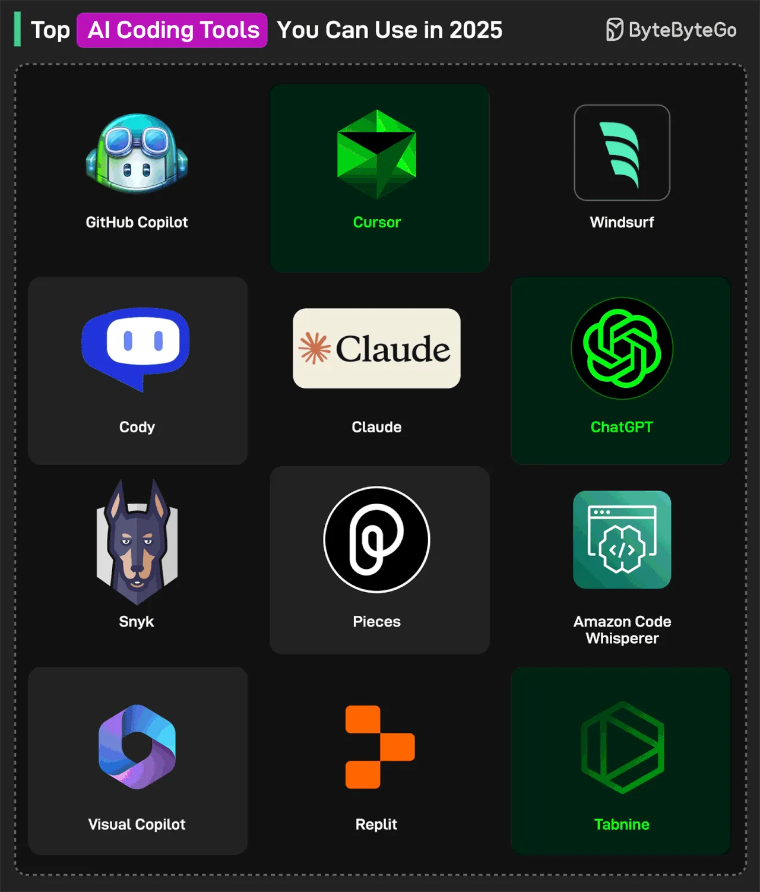

# 058 - Top AI Coding Tools for Developers You Can Use in 2025

- Source: ByteByteGo Big Archive System Design 2025
- PDF pages: 120-121
- Figures: 1

## Figures

## Original Extracted Text

1. AI Code Assistants
     GitHub Copilot: Code completion and automatic programming tool.

     ChatGPT: Helps write and debug code with the latest models.

     Claude: Recent and specialized coding knowledge to generate accurate and up-to-date
     code.

     Amazon CodeWhisperer: AI Assistant in the IDE

   2. AI-Powered IDEs
       Cursor: AI-powered IDE for Windows, macOS, and Linux.

       Windsurf: AI-powered IDE that tackles complex tasks independently.

       Replit: Create fully working apps to go live fast.

   3. Team Productivity
       Cody: The enterprise AI code assistant for writing, fixing, and maintaining code.

       Pieces: AI-enabled productivity tool to help developers manage code snippets.

       Visual Copilot: Convert Figma designs into React, Vue, Svelte, Angular, or HTML code.

   4. Code Quality and Completion
       Snyk: Real-time vulnerability scanning of human and AI-generated code.

       Tabnine: A code completion tool to accelerate software development.

Over to you: Which other AI Coding Tool will you add to the list? What's your favorite?
