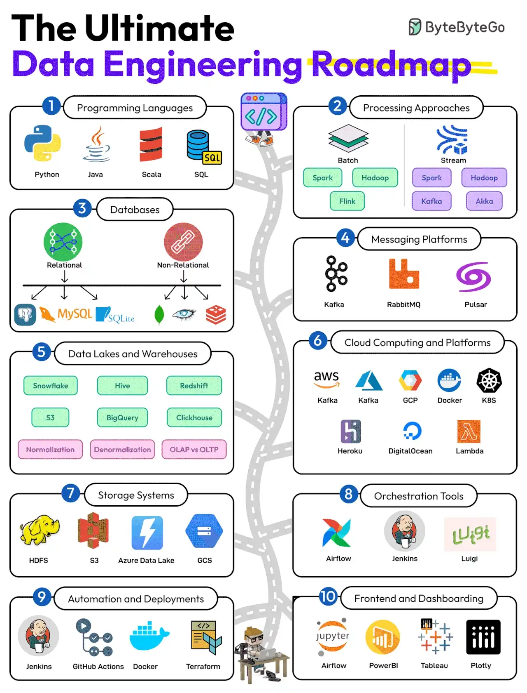
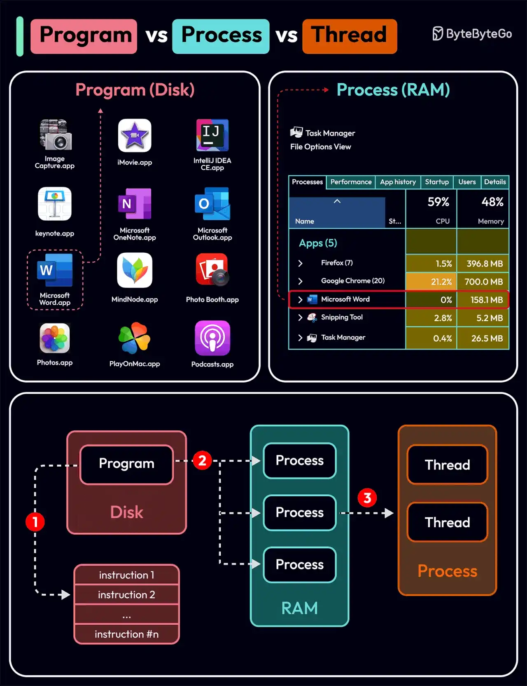

# 060 - The Data Engineering Roadmap

- Source: ByteByteGo Big Archive System Design 2025
- PDF pages: 124-127
- Figures: 2

## Figures

## Original Extracted Text

Data engineering has become the backbone of effective data analysis. It involves managing,
processing, and optimizing data to derive actionable insights.

Here's a roadmap that can help you get better at data engineering:

   1. Programming Languages
       Learn SQL and a few programming languages like Python, Java, and Scala.

   2. Processing Techniques
       Learn batch processing tools like Spark and Hadoop and stream processing tools like Flink
       and Kafka.

   3. Databases
       Focus on both relational and non-relational databases. Some examples are MySQL,
       Postgres, MongoDB, Cassandra, and Redis.

   4. Messaging Platforms
       Master the use of platforms like Kafka, RabbitMQ, and Pulsar.

   5. Data Lakes and Warehouses
       Learn about various data lake and warehousing solutions such as Snowflake, Hive, S3,
       Redshift, and Clickhouse. Also, learn about Normalization, Denormalization, and OLTP vs
       OLAP.

   6. Cloud Computing Platforms
       Master the use of cloud platforms like AWS, Azure, Docker, and K8S

   7. Storage Systems
       Learn about the key storage systems like S3, Azure Data Lake, and HDFS

   8. Orchestration Tools
       Learn about orchestration tools like Airflow, Jenkins, and Luigi

   9. Automation and Deployments
       Learn automation tools such as Jenkins, Github Actions, and Terraform.

   10.Frontend and Dashboarding
       Master the use of tools like Jupyter Notebooks, PowerBI, Tableau, and Plotty

Over to you: What else will you add to the Data Engineering Roadmap?

Popular interview question: What is the difference
between Process and Thread?

To better understand this question, let's first take a look at what is a Program. A Program is an
executable file containing a set of instructions and passively stored on disk. One program can have
multiple processes. For example, the Chrome browser creates a different process for every single
tab.

A Process means a program is in execution. When a program is loaded into the memory and
becomes active, the program becomes a process. The process requires some essential resources
such as registers, program counter, and stack.

A Thread is the smallest unit of execution within a process.

The following process explains the relationship between program, process, and thread.

   1. The program contains a set of instructions.

   2. The program is loaded into memory. It becomes one or more running processes.

   3. When a process starts, it is assigned memory and resources. A process can have one or
       more threads. For example, in the Microsoft Word app, a thread might be responsible for
       spelling checking and the other thread for inserting text into the doc.

Main differences between process and thread:

   ● Processes are usually independent, while threads exist as subsets of a process.

   ● Each process has its own memory space. Threads that belong to the same process share
      the same memory.

   ● A process is a heavyweight operation. It takes more time to create and terminate.

   ● Context switching is more expensive between processes.

   ● Inter-thread communication is faster for threads.

Over to you:

   1. Some programming languages support coroutines. What is the difference between coroutine
       and thread?

   2. How to list running processes in Linux?
