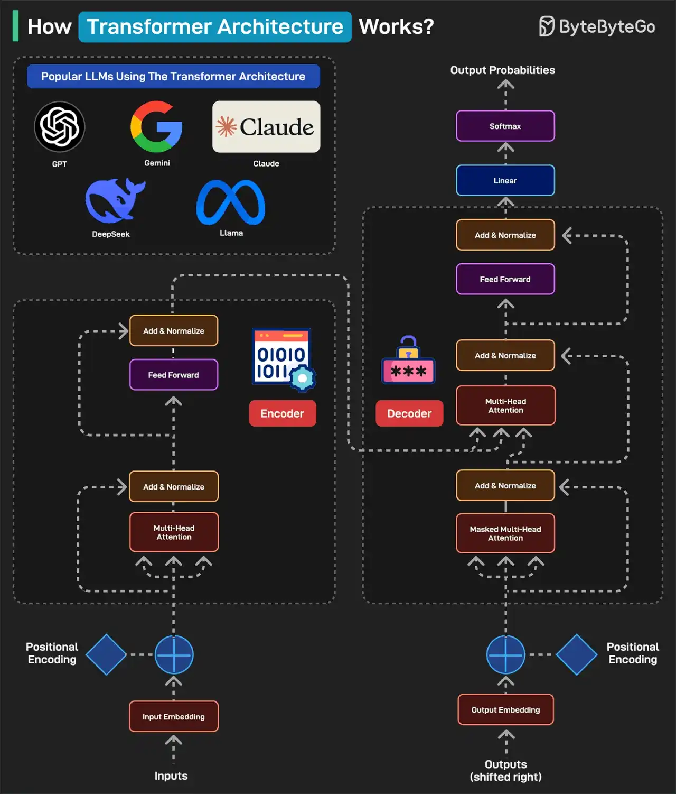

# 062 - Everyone talks about Transformers. How Transformers Architecture Works?

- Source: ByteByteGo Big Archive System Design 2025
- PDF pages: 130-131
- Figures: 1

## Figures

## Original Extracted Text

Transformers Architecture has become the foundation of some of the most popular LLMs including
GPT, Gemini, Claude, DeepSeek, and Llama.

Here's how it works:
   1. A typical transformer-based model has two main parts: encoder and decoder. The encoder
       reads and understands the input. The decoder uses this understanding to generate the
       correct output.

   2. In the first step (Input Embedding), each word is converted into a number (vector)
       representing its meaning.

   3. Next, a pattern called Positional Encoding tells the model where each word is in the
       sentence. This is because the word order matters in a sentence. For example "the cat ate
       the fish" is different from "the fish ate the cat".

   4. Next is the Multi-Head Attention, which is the brain of the encoder. It allows the model to look
       at all words at once and determine which words are related. In the Add & Normalize phase,
       the model adds what it learned from attention back into the sentence.

   5. The Feed Forward process adds extra depth to the understanding. The overall process is
       repeated multiple times so that the model can deeply understand the sentence.

   6. After the encoder finishes, the decoder kicks into action. The output embedding converts
       each word in the expected output into numbers. To understand where each word should go,
       we add Positional Encoding.

   7. The Masked Multi-Head Attention hides the future words so the model predicts only one
       word at a time.

   8. The Multi-Head Attention phase aligns the right parts of the input with the right parts of the
       output. The decoder looks at both the input sentence and the words it has generated so far.

   9. The Feed Forward applies more processing to make the final word choice better. The
       process is repeated several times to refine the results.

   10.Once the decoder has predicted numbers for each word, it passes them through a Linear
       Layer to prepare for output. This layer maps the decoder's output to a large set of possible
       words.

   11. After the Linear Layer generates scores for each word, the Softmax layer converts those
        scores into probabilities. The word with the highest probability is chosen as the next word.

   12.Finally, a human-readable sentence is generated.

Over to you: What else will you add to understand the Transformer Architecture?
