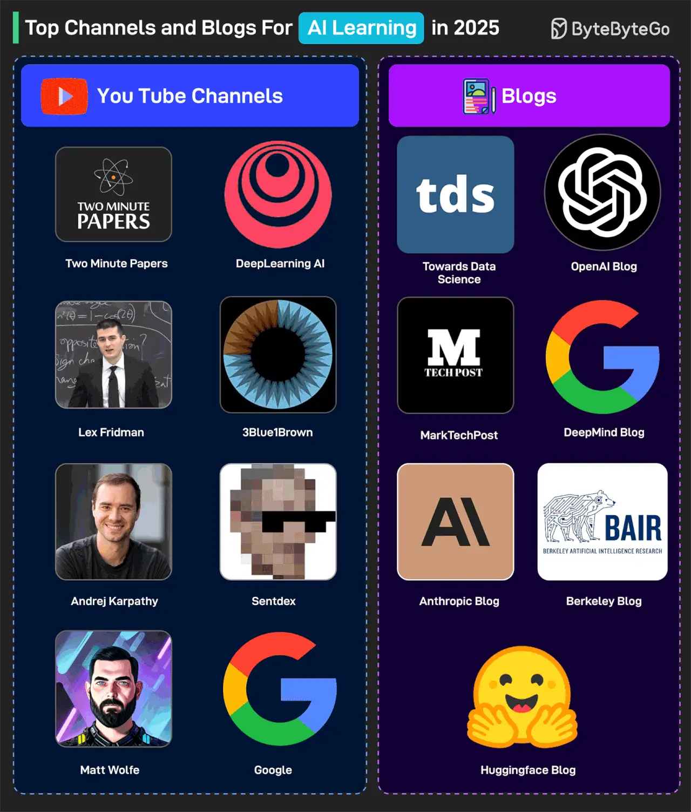

# 063 - Top YouTube Channels and Blogs for AI Learning in 2025

- Source: ByteByteGo Big Archive System Design 2025
- PDF pages: 132-133
- Figures: 1

## Figures

## Original Extracted Text

Some great YouTube Channels are:

   1. Two Minute Papers

   2. DeepLearning AI

   3. Lex Fridman

   4. 3Blue1Brown

   5. Andrej Karpathy

   6. Sentdex

   7. Matt Wolfe

   8. Google YouTube Channel

Also, here are some great blogs focusing on AI:

   1. TowardsDataScience

   2. OpenAI Blog

   3. MarkTechPost

   4. DeepMind Blog

   5. Anthropic Blog

   6. Berkeley Bair

   7. Huggingface Blog

Over to you: Which other channel and blog will you add to the list?
