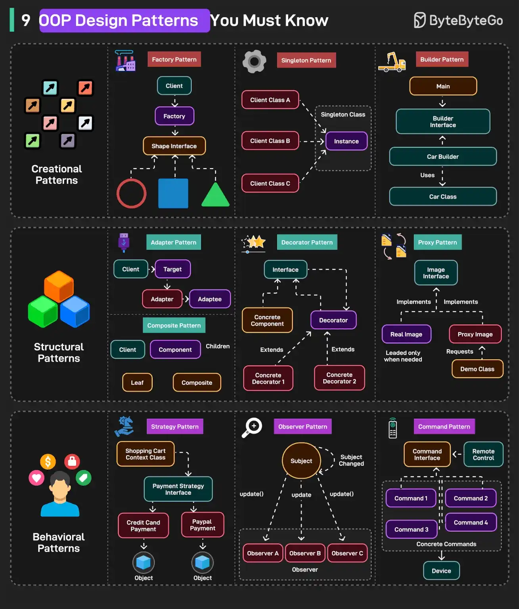
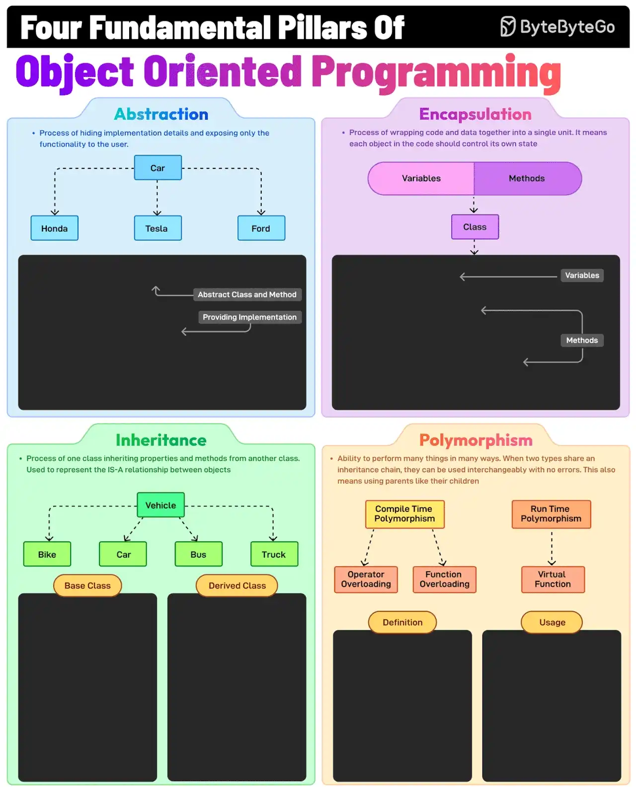

# 065 - 9 OOP Design Patterns You Must Know

- Source: ByteByteGo Big Archive System Design 2025
- PDF pages: 139-142
- Figures: 2

## Figures

## Original Extracted Text

These patterns can be divided into 3 categories:
A - Creational Patterns
Deal with object creation mechanism to decouple the client code from concrete classes.

   1. Factory Pattern: Centralizes object creation logic and returns different subclasses based on
       input

   2. Singleton Pattern: Ensures only one instance of a class exists and provides global access to
       it.

   3. Builder Pattern: Constructs complex objects step-by-step, allowing optional configuration.

B - Structural Patterns
Help compose classes and objects into larger structures.

   1. Adapter Pattern: Allows incompatible interfaces to work together by translating one interface
       into another.

   2. Decorator Pattern: Adds new behavior to objects dynamically without altering their original
       structure.

   3. Proxy Pattern: Acts as a placeholder for accessing another object.

C - Behavioral Patterns
Focus on communication and interaction between objects.

   1. Strategy Pattern: Allows selecting an algorithm or behavior from a family of interchangeable
       strategies at runtime.

   2. Observer Pattern: Enables a one-to-many dependency so that when one object changes
       state, all its dependents are notified.

   3. Command Pattern: An object encapsulates all information needed to perform an action or
       trigger an event.

Over to you: Which of these patterns have you used?

The Fundamental Pillars of Object-Oriented
Programming

Abstraction, Encapsulation, Inheritance, and Polymorphism are the four pillars of object-oriented
programming. What do they mean?

   1. Abstraction
       This is the process of hiding implementation details and showing only the essential features

       of an object. For example, a Vehicle class with an abstract stop method.

   2. Encapsulation
       It involves wrapping data (fields) and methods in a single unit (class) and restricting direct
       access using access modifiers. For example, private fields with public getters and setters.

   3. Inheritance
       The process of creating a new class (child) that inherits attributes and methods from an
       existing class (parent), thereby promoting code reuse. For example, a Car class inherits from
       a Vehicle class.

   4. Polymorphism
       It allows methods to perform differently based on the object they are invoked on. When two
       types share an inheritance chain, they can be used interchangeably with no errors.

Over to you: Do you use object-oriented programming?
