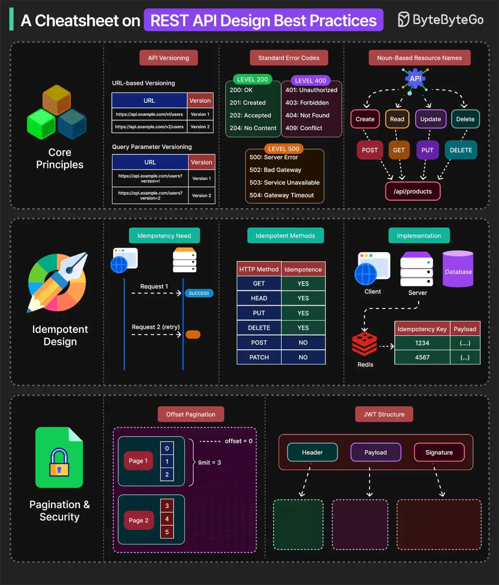

# 066 - A Cheatsheet on REST API Design Best Practices

- Source: ByteByteGo Big Archive System Design 2025
- PDF pages: 143-144
- Figures: 1

## Figures

## Original Extracted Text

Well-designed APIs behave consistently, fair predictably, and grow without friction. Some best
practices to keep in mind are as follows:

   1. Resource-oriented paths and proper use of HTTP verbs help APIs align with standard tools.

   2. Use a proper API versioning approach.

   3. Use standard error codes while generating API responses.

   4. APIs should be idempotent. They ensure safe retries by making repeated requests to
       produce the same result, especially for POST operations.

   5. Idempotency keys allow clients to safely deduplicate operations with side effects.

   6. APIs should support pagination to prevent performance bottlenecks and payload bloat. Some
       common pagination strategies are offset-based, cursor-based, and keyset-based.

   7. API security is mandatory for well-designed APIs. Use proper authentication and
       authorization with APIs using API Keys, JWTs, OAuth2, and other mechanisms. HTTPS is
       also a must-have for APIs running in production.

Over to you: Which other best practices do you follow while designing APIs?
