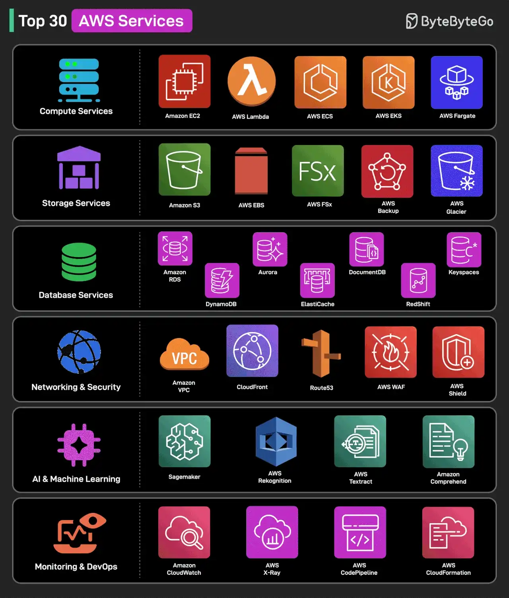

# 067 - Top 30 AWS Services That Are Commonly Used

- Source: ByteByteGo Big Archive System Design 2025
- PDF pages: 145-146
- Figures: 1

## Figures

## Original Extracted Text

We group them by category and understand what they do.

Compute Services
1 - Amazon EC2: Virtual servers in the cloud
2 - AWS Lambda: Serverless functions for event-driven workloads
3 - Amazon ECS: Managed container orchestration
4 - Amazon EKS: Kubernetes cluster management service
5 - AWS Fargate: Serverless compute for containers

Storage Services
6 - Amazon S3: Scalable secure object storage
7 - Amazon EBS: Block storage for EC2 instances
8 - Amazon FSx: Fully managed file storage
9 - AWS Backup: Centralized backup automation

10 - Amazon Glacier: Archival cold storage for backups

Database Services
11 - Amazon RDS: Managed relational database service
12 - Amazon DynamoDB: NoSQL database with low latency
13 - Amazon Aurora: High-performance cloud-native database
14 - Amazon Redshift: Scalable data warehousing solution
15 - Amazon Elasticache: In-memory caching with Redis/Memcached
16 - Amazon DocumentDB: NoSQL document database (MongoDB-compatible)
17 - Amazon Keyspaces: Managed Cassandra database service

Networking & Security
18 - Amazon VPC: Secure cloud networking
19 - AWS CloudFront: Content Delivery Network
20 - AWS Route53: Scalable domain name system (DNS)
21 - AWS WAF: Protects web applications from attacks
22 - AWS Shield: DDoS protection for AWS workloads

AI & Machine Learning
23 - Amazon SageMaker: Build, train, and deploy ML models
24 - AWS Rekognition: Image and video analysis with AI
25 - AWS Textract: Extracts text from scanned documents
26 - Amazon Comprehend: AI-driven natural language processing

Monitoring & DevOps
27 - Amazon CloudWatch: AWS performance monitoring and alerts
28 - AWS X-Ray: Distributed tracing for applications
29 - AWS CodePipeline: CI/CD automation for deployments
30 - AWS CloudFormation - Infrastructure as Code (IaC)

Over to you: Which other AWS service will you add to the list?
