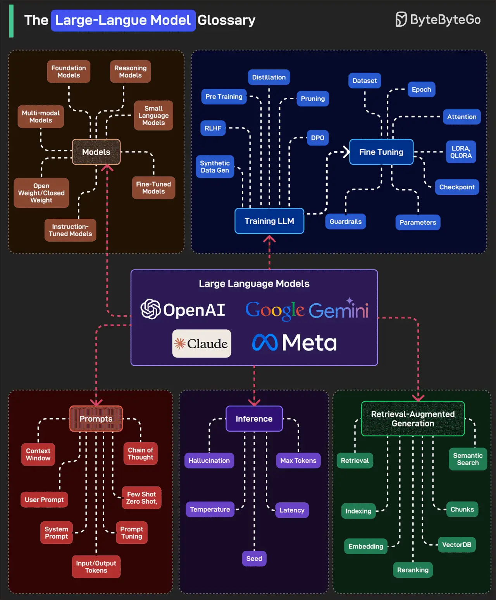

# 068 - The Large-Language Model Glossary

- Source: ByteByteGo Big Archive System Design 2025
- PDF pages: 147-148
- Figures: 1

## Figures

## Original Extracted Text

This glossary can be divided into high-level categories:

   1. Models: Includes the types of models such as Foundation, Instruction-Tuned, Multi-modal,
       Reasoning, and Small Language Model.

   2. Training LLM: Training begins with pretraining RLHF, DPO, and Synthetic Data. Fine-Tuning
       adds control with datasets, checkpoints, LoRA/QLoRA, guardrails, and parameter tunings.

   3. Prompts: Prompts drive how models respond using User/System Prompts, Chain of Thought,
       of Few/Zero-Shot learning. Prompt Tuning and large Context Windows help shape more
       precise, multi-turn conversations.

   4. Inference: This is how models generate responses. Key factors include Temperature, Max
       Tokens, Seed, and Latency. Hallucination is a common issue here, where the model makes
       things up that sound real.

   5. Retrieval-Augmented Generation: RAG improves accuracy by fetching real-world data. It
       uses Retrieval, Semantic Search, Chunks, Embeddings, and VectorDBs. Reranking and
       Indexing ensure the best answers are surfaced, not just the most likely ones.

Over to you: What else will you add to the LLM glossary?
