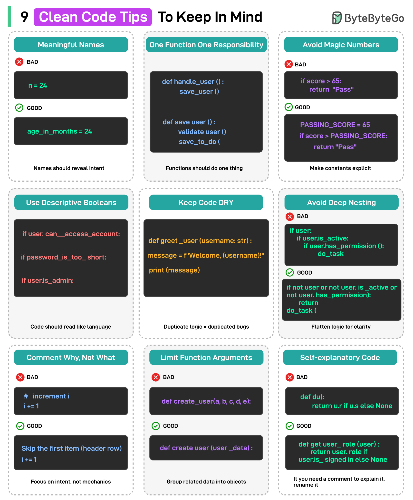

# 069 - 9 Clean Code Principles To Keep In Mind

- Source: ByteByteGo Big Archive System Design 2025
- PDF pages: 149-150
- Figures: 2

## Figures

## Original Extracted Text

1. Meaningful Names: Name variables and functions to reveal their purpose, not just their
     value.

   2. One Function, One Responsibility: Functions should do one thing.

   3. Avoid Magic Numbers: Replace hard-code values with named constants to give them
       meaning.

   4. Use Descriptive Booleans: Boolean names should state a condition, not just its value.

   5. Keep Code DRY: Duplicate code means duplicate bugs. Try and reuse logic where it makes
       sense.

   6. Avoid Deep Nesting: Flatten your code flow to improve clarity and reduce cognitive load.

   7. Comment Why, Not What: Explain the intention behind your code, not the obvious
       mechanics.

   8. Limit Function Arguments: Too many parameters confuse. Group related data into objects.

   9. Code Should Be Self-Explanatory: Well-written code needs fewer comments because it
       reads like a story.

Over to you: Which other clean code principle will you add to the list?
