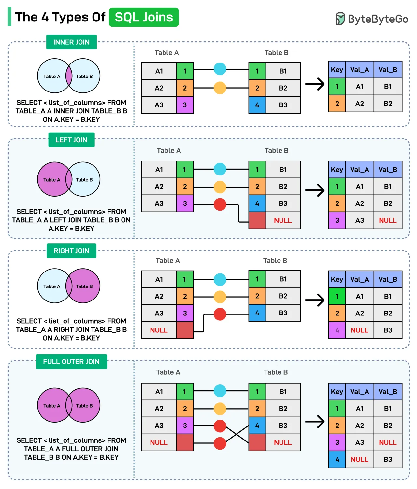

# 070 - The 4 Types of SQL Joins

- Source: ByteByteGo Big Archive System Design 2025
- PDF pages: 151-152
- Figures: 1

## Figures

## Original Extracted Text

SQL joins combine rows from two or more tables based on a related column. Here are the different
types of joins you can use:

   1. Inner Join
       Returns only the matching rows between both tables. It keeps common data only.

   2. Left Join
       Returns all rows from the left table and matching rows from the right table. If a row in the left

       table doesn't have a match in the right table, the right table's columns will contain NULL
       values in that row.

   3. Right Join
       Returns all rows from the right table and matching rows from the left table. If no matching
       record exists in the left table for a record in the right table, the columns from the left table in
       the result will contain NULL values.

   4. FULL OUTER JOIN
       Returns all rows from both tables, filling in NULL for missing matches.

Over to you: Which SQL Join have you used the most?
