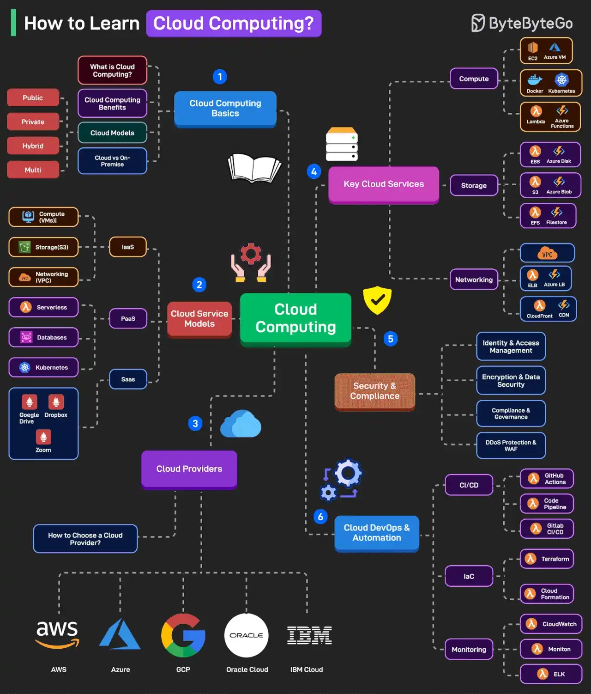

# 071 - How to Learn Cloud Computing?

- Source: ByteByteGo Big Archive System Design 2025
- PDF pages: 153-154
- Figures: 1

## Figures

## Original Extracted Text

Cloud computing is a vast field with an ever-growing footprint. It can often get tricky for a new
developer to understand where to start. Here's a learning map:

    1. Cloud Computing Basics
        This includes topics such as "what is cloud computing," its benefits, cloud models (public,
        private, hybrid, and multi), and a comparison of cloud vs. on-premise.

   2. Cloud Service Models
       Learn about cloud service models such as IaaS, PaaS, and SaaS.

   3. Cloud Providers
       Explore the various popular cloud platforms such as AWS, Azure, GCP, Oracle Cloud, IBM
       Cloud, etc. Also, learn how to choose a cloud provider.

   4. Key Cloud Services
       Learn the key cloud services related to Compute (EC2, Azure VM, Docker, Kubernetes,
       Lambda, etc), Storage (EBS, Azure Disk, S3, Azure Blob, EFS, etc.), and Networking (VPC,
       ELB, Azure LB, Cloudfront, and Azure CDN).

   5. Security & Compliance
       Learn about the critical security and compliance points related to identity, access
       management, encryption, data security, DDoS protection, and WAF.

   6. Cloud DevOps & Automation
       Learn Cloud DevOps and automation in specific areas such as CI/CD, IaC, and Monitoring.

Over to you: What else will you add to the list for learning cloud computing?
