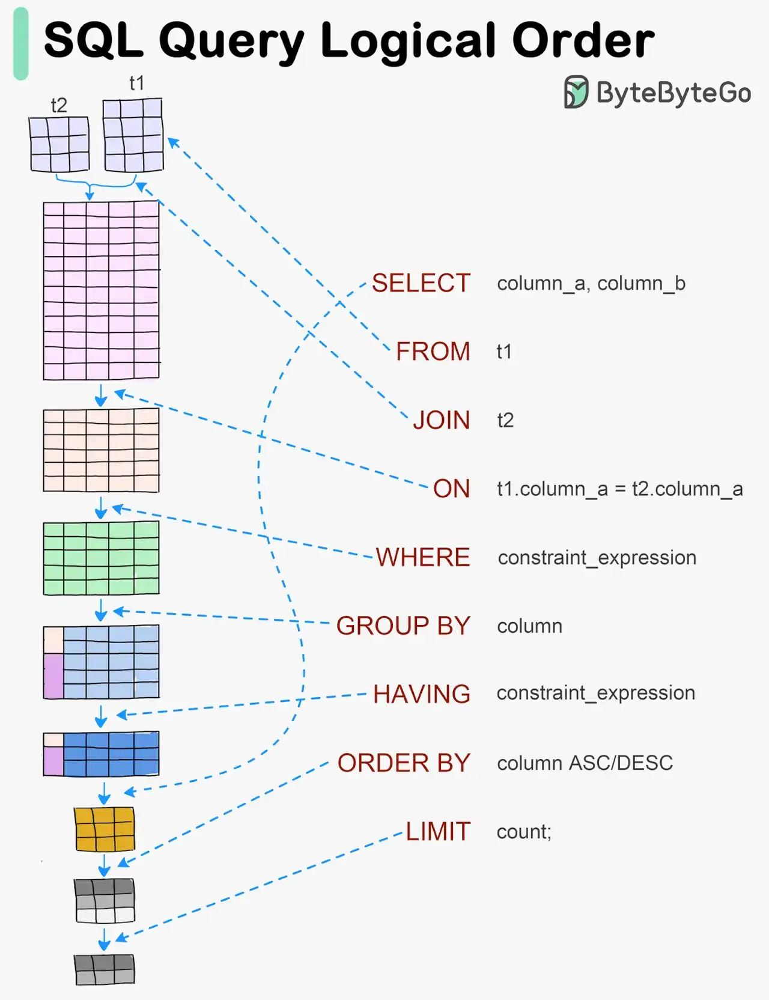

# 072 - Visualizing a SQL query

- Source: ByteByteGo Big Archive System Design 2025
- PDF pages: 155-155
- Figures: 1

## Figures

## Original Extracted Text

SQL statements are executed by the database system in several steps, including:

   ● Parsing the SQL statement and checking its validity

   ● Transforming the SQL into an internal representation, such as relational algebra

   ● Optimizing the internal representation and creating an execution plan that utilizes index
      information

   ● Executing the plan and returning the results
